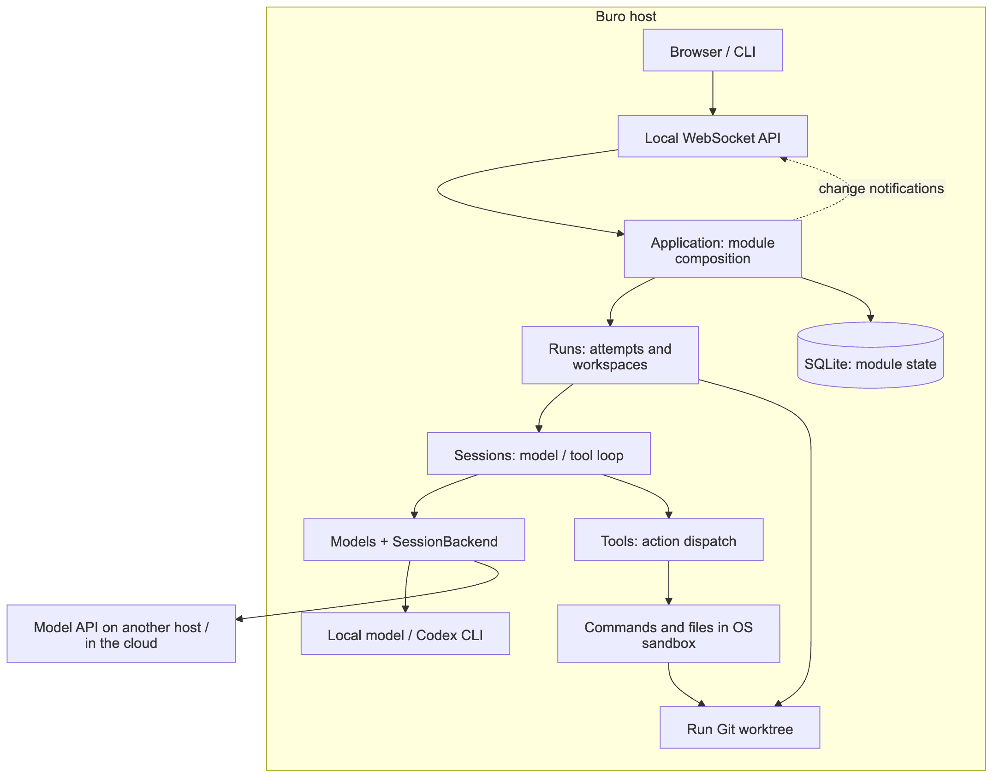
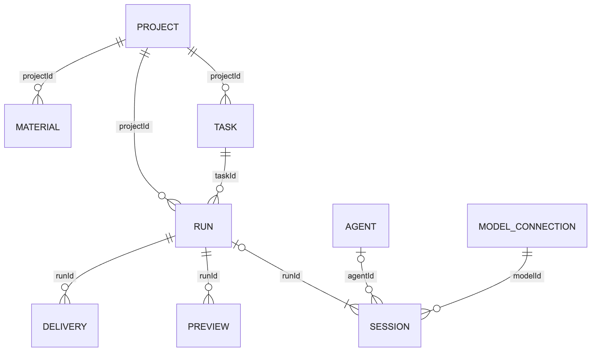
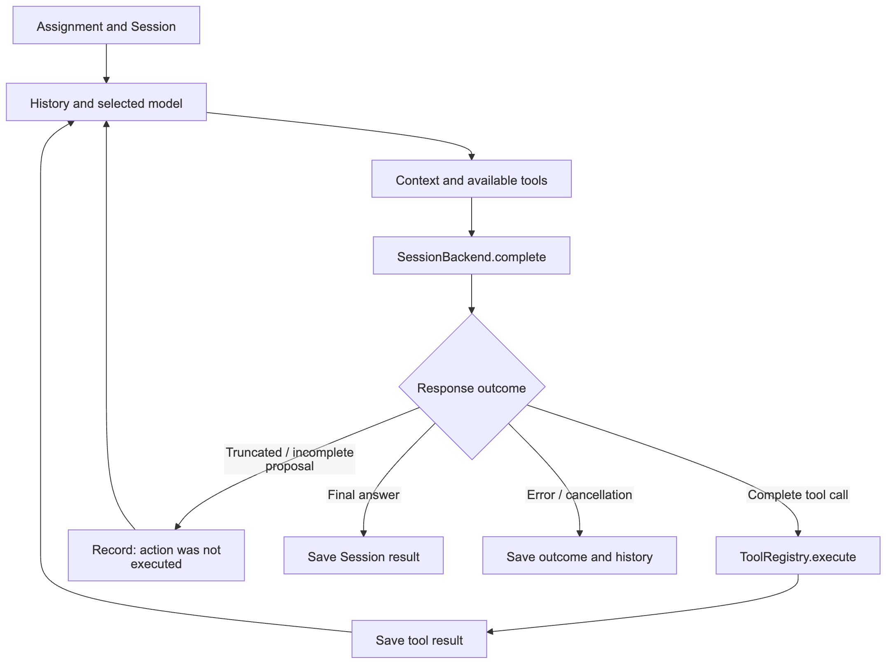
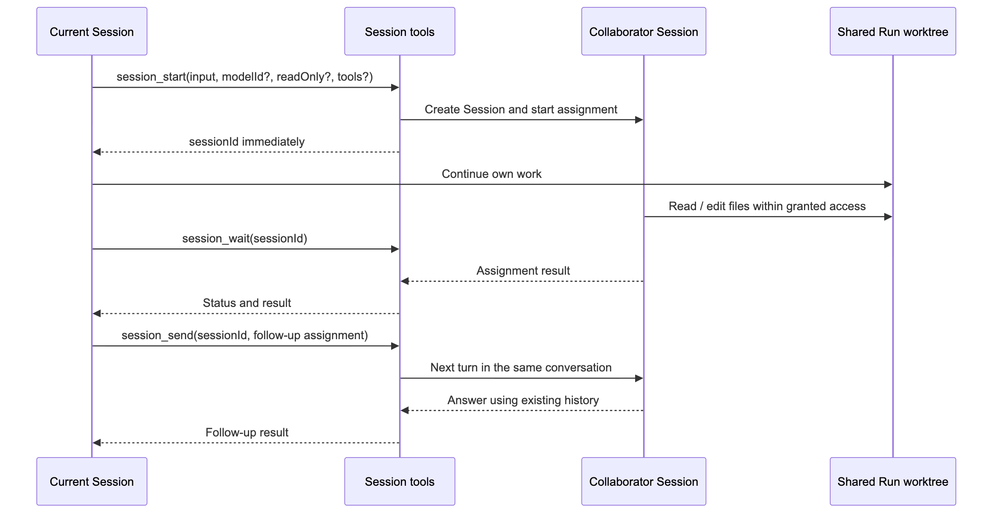
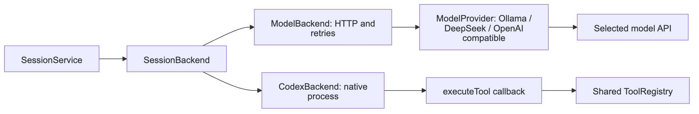
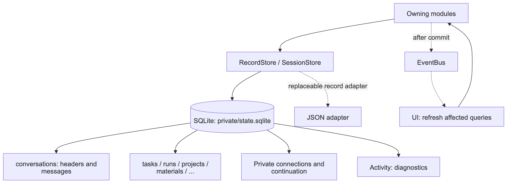
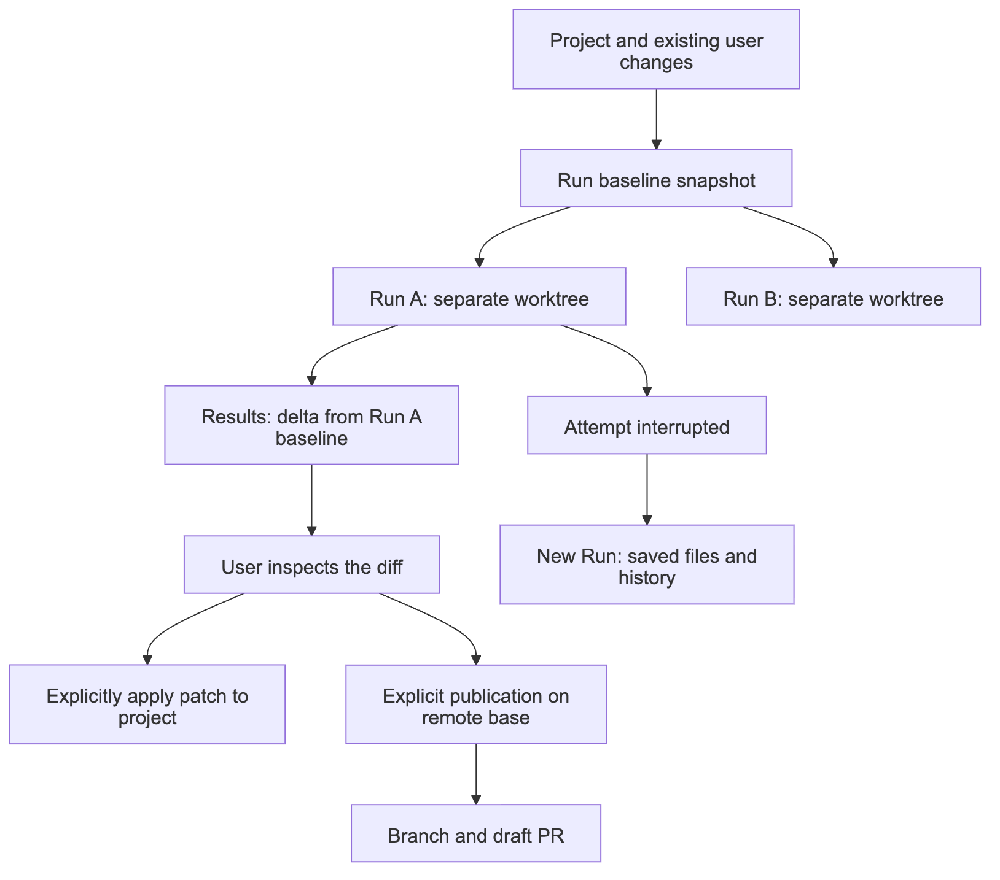
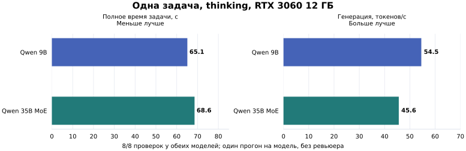

# Architecture

Buro is a local workspace for tasks carried out by agents. The user describes an outcome, the application creates an isolated attempt, and agents choose tools, models and collaborators. The server owns state, files and execution lifetimes; the quality of the result also depends on the model and how it organizes the work.

This page reflects the implementation on November 25, 2026. Planned changes are marked separately. Comparisons use official project documentation, not measurements of their models' coding quality.

| Status                      | Scope                                                                                                                                           |
| --------------------------- | ----------------------------------------------------------------------------------------------------------------------------------------------- |
| Implemented                 | One server, independent modules, SQLite, a shared session loop, model switching, collaborators, Git worktrees, UI/CLI, previews and publication |
| Selected, migration pending | UI FSD, shared contracts, short filenames, public index.ts entry points, import aliases and test groups                                         |
| Under evaluation            | Reliable collaboration with small models and efficient context on large projects                                                                |

## 1. System overview



[Diagram source](docs/assets/architecture/system.mmd)

One server process composes feature modules through ordinary method calls. Commands, previews and native Codex run in child processes. A remote model endpoint moves generation to another host; Buro's tools still execute on the application host.

`Application` composes interfaces and closes resources. Each feature owns its records instead of sharing one mutable application snapshot. Constructors receive the dependencies they need. See [createApplication](modules/application/create-application.ts) and the [Application interface](modules/application/application.ts).

The API binds to loopback and requires authentication. UI and CLI use the same methods. Commands return results directly; notifications identify data to refresh. Subscribers do not orchestrate execution. See the [API server](modules/api/server.ts), [contract](modules/api/contract.ts) and [EventBus](modules/events/event-bus.ts).

## 2. Entities and relationships



[Diagram source](docs/assets/architecture/entities.mmd)

These are logical identifier references, not SQL foreign-key constraints. Historical runs may survive deletion of their task or model connection. A session can also exist without a run.

| Entity           | Owns                                                                      |
| ---------------- | ------------------------------------------------------------------------- |
| Project          | A connected source directory                                              |
| Task             | Editable intent and description, independent of attempts                  |
| Run              | One attempt, worktree, root session and outcome                           |
| Session          | Conversation, selected model, messages, access and result                 |
| Agent            | Optional reusable description and instructions; names grant no privileges |
| Model connection | Transport configuration and its private credential                        |
| Material         | A retained attachment, metadata and extracted text                        |
| Preview          | A preview process and its port                                            |
| Delivery         | An explicitly requested publication and its observed outcome              |

A task can have multiple attempts. A session keeps its identity when its model changes. `parentId` links collaborators; `previousRunId` links attempts. They represent different relationships.

## 3. Agent loop



[Diagram source](docs/assets/architecture/agent-loop.mmd)

[SessionService](modules/sessions/session-service.ts) implements the loop. HTTP adapters return tool proposals; native backends may invoke tools through a callback. Both paths use the same [ToolRegistry](modules/tools/tool-registry.ts).

The response is saved before its proposed tools execute. Incomplete proposals do not become actions. Expected tool failures return as results the model can act on. Configurable retries of temporary HTTP failures repeat generation, not commands that have already executed.

A model can be selected for a run or session and changed for the next request through `model_select`. There is no mandatory router based on agent roles. An individual `SessionTurn` can receive an optional `maxRequests` allowance; it is unset by default and belongs to the caller's execution options, not quality evaluation.

`completed` means execution returned a result. Tests, review or manual inspection establish whether the code is correct. Synthetic benchmark assertions are outside the ordinary run. The loop defines no fixed roles, team size, phase order or minimum score.

## 4. Collaboration



[Diagram source](docs/assets/architecture/collaboration.mmd)

A collaborator is another session using the same loop. A saved agent description is optional: callers can supply the assignment, instructions and model directly. A collaborator inherits shared task background, explicitly labeled as reference information; its current assignment arrives in a separate conversation message. The parent's full history is not copied automatically.

Read-only access is inherited, and the available tool set can narrow. Waiting tracks circular dependencies between sessions. When a run's root work finishes, its background sessions are stopped and joined before the attempt finishes. See [session tools](modules/agents/session-tools.ts) and [Sessions.wait](modules/sessions/session-service.ts).

Review is an ordinary exchange: request an independent opinion, read findings, fix the code and send the revision back. It does not require a separate workflow engine.

Delegation freedom alone does not prevent coordination failures. In the current Qwen 9B diagnostic, agents repeatedly delegated the same assignment and reread files. The scenario was stopped after 31.6 minutes: 9 collaborators and 261 requests. Model behavior, shared context and tool descriptions have not yet been isolated experimentally as causes.

Qwen 35B completed the review scenario on the same code revision with 8/8 checks in 647.8 seconds, using 7 collaborators and 70 requests. Its result was correct on this task, but collaboration remained expensive. Aggregates for both scenarios are in the [measurement snapshot](docs/assets/architecture/rtx-sample.json); these are individual experiments, not a general model ranking.

## 5. Backends, models and context



[Diagram source](docs/assets/architecture/backends.mmd)

[SessionBackend](modules/engines/backend.ts) separates the application loop from execution mechanics. [ModelProvider](agent/contracts/model.ts) defines portable messages, tools, completions, usage and text streams. `agent/` contains these contracts and providers; the loop that owns files and processes currently remains in `modules/`.

History stores messages, not requests already formatted for one provider. Before a request, the application attaches compatible private adapter continuation and constructs a bounded context view. Private state is associated with the model, backend revision and message identity; switching models does not attach another adapter's continuation. Projection does not alter saved history.

Context size currently uses an approximate serialized-size estimate. Instructions, the initial and current assignments, and complete tool-call/result exchanges are retained. Large tool results may be shortened in the request view. Exact tokenization, semantic summarization and a repository index are not implemented yet. See [conversationContext](modules/sessions/context.ts) and [ModelRegistry](modules/models/model-registry.ts).

## 6. Persistence and UI updates



[Diagram source](docs/assets/architecture/storage.mmd)

SQLite stores records in module-owned namespaces within one file. `RecordStore` returns detached values and allows a different storage implementation. Diagnostic activity is separate from current entity state and is not replayed to reconstruct the application.

Conversation metadata and individual messages share a namespace, allowing an atomic append of new messages and the updated header. Ordinary turns do not rewrite earlier messages. Session lists return metadata; `sessions.messages` reads bounded pages using stable positions. Execution loads the selected conversation into memory in pages. The JSON adapter preserves the contract but physically rewrites its namespace file. See [ConversationStore](modules/sessions/conversation-store.ts) and [SqliteStorage](modules/storage/sqlite-storage.ts).

Credentials and private continuation stay out of public messages and notifications. This is a logical separation: the server owns both kinds of records. The application targets one local user; tenant isolation is not implemented.

UI queries subscribe to relevant entity and owner changes. A bounded refresh window coalesces notifications without postponing updates indefinitely. Changes during an in-flight read trigger another read after it finishes. Reconnection refreshes records without replaying commands. Provisional response text is displayed separately. See [queryAffected](src/data/query-notifications.ts), [QuerySubscription](src/data/query-subscription.ts) and [SessionView](src/features/runs/SessionView.tsx).

## 7. Files, results and recovery



[Diagram source](docs/assets/architecture/workspaces.mmd)

On an ordinary start, existing user changes become the run's baseline. The result is the agent's subsequent delta. Worktree creation serializes only Git bookkeeping for a repository; independent runs still execute concurrently.

Collaborators within one run share files and must coordinate writes. Different runs use separate worktrees. A worktree isolates attempt files; the OS sandbox separately constrains processes. Commands and file tools use macOS `sandbox-exec` or Linux `bubblewrap`. A supported Windows command sandbox is not implemented yet. Previews use the same command adapter with a separate lifetime.

Applying and publishing are independent of completion. Publication creates a workspace on a remote base and applies only the attempt's patch. PR descriptions remain empty unless explicitly supplied. See [GitWorkspaces](modules/workspaces/git-workspaces.ts), [ResultService](modules/results/result-service.ts) and [DeliveryService](modules/deliveries/delivery-service.ts).

Startup acquires ownership of the application directory before marking abandoned work interrupted. Continuing creates a new attempt with saved files and portable history. It does not restore an exact internal instruction pointer or automatically repeat actions with uncertain external outcomes. Interrupted publications are not automatically restarted.

## 8. Extension boundaries and source layout

| Contract                     | Replace or add                                | Definition                                                                                    |
| ---------------------------- | --------------------------------------------- | --------------------------------------------------------------------------------------------- |
| SessionBackend               | HTTP model or native agent process            | [backend.ts](modules/engines/backend.ts)                                                      |
| ModelTransport               | Backend construction from connection settings | [model-configuration.ts](modules/models/model-configuration.ts)                               |
| Tool                         | Action definition, effect and implementation  | [tool.ts](modules/tools/tool.ts)                                                              |
| StorageEngine / SessionStore | Records and conversation persistence          | [record-store.ts](modules/storage/record-store.ts), [session.ts](modules/sessions/session.ts) |
| CommandSandbox               | Process execution environment                 | [sandbox.ts](modules/commands/sandbox.ts)                                                     |
| MaterialLoader               | Attachment format extraction                  | [material.ts](modules/materials/material.ts)                                                  |
| ResultPublisher              | External publication mechanism                | [delivery.ts](modules/deliveries/delivery.ts)                                                 |

Adapters are composed in `createApplication`; tools register through `Tools.register`. Replacing a backend does not require another role or a branch in the session loop. Plugin installation, discovery and versioning are not implemented. Existing interfaces provide boundaries for packaging modules later.

Small server modules remain flat. The selected UI conventions are FSD and Atomic Design within shared components. Public `index.ts` entry points, aliases and root `shared/contracts` for common DTOs are planned. Internal storage interfaces remain with their owners. This migration is pending; see [folder conventions](docs/STRUCTURE.md) for target paths.

## 9. Related projects

This comparison concerns architecture. Agents SDK is a library for building applications; the other projects are agent tools or platforms. The table does not imply that unlisted features are absent.

| Project           | Main approach                                                                                                                                                                                                                                                                            | Relevant lesson for Buro                                                         |
| ----------------- | ---------------------------------------------------------------------------------------------------------------------------------------------------------------------------------------------------------------------------------------------------------------------------------------- | -------------------------------------------------------------------------------- |
| Buro              | Task / Run / Session, an attempt worktree, one loop and direct module calls                                                                                                                                                                                                              | Keep intent, attempts and conversations distinct; replace adapters independently |
| OpenCode          | Server APIs for sessions, models, tools and events; primary/subagent/all profiles and child conversations; packaged and local plugins. [API](https://opencode.ai/docs/api), [agents](https://opencode.ai/docs/agents/), [plugins](https://opencode.ai/docs/plugins/)                     | Clear capability APIs, separate collaborator context and extension entry points  |
| OpenHands         | Agent Canvas is separate from SDK and Agent Server. The SDK defines conversations, tools and workspaces; environments can use Local, Docker or RemoteAPI workspaces. [Components](https://docs.openhands.dev/overview/introduction), [SDK](https://docs.openhands.dev/sdk/arch/overview) | Separate remote execution from the client and model when needed                  |
| Aider             | Git commits and undo; a repository map selects relevant symbols using a dependency graph and context budget. [Git](https://aider.chat/docs/git.html), [repository map](https://aider.chat/docs/repomap.html)                                                                             | Compact code navigation and understandable changes                               |
| OpenAI Agents SDK | Agents combine instructions, models and tools. Agents-as-tools keeps control with the caller; handoffs transfer the conversation. [Composition](https://openai.github.io/openai-agents-js/guides/agents/#composition-patterns)                                                           | Distinguish a collaborator assignment from transferring control                  |

OpenCode documents fresh context in child sessions. Buro also uses separate collaborator history, but inherits shared run background. **Our hypothesis:** test an explicit assignment packet containing the task, relevant facts and expected result to reduce ambiguity. This is not a demonstrated fix for the observed loop. [Comparison basis](https://opencode.ai/docs/agents/#modes).

OpenHands offers a useful distinction between conversations and workspaces; its distributed infrastructure is not currently needed for Buro's local deployment. Aider's repository map could become an optional capability. Agents SDK helps distinguish tool-like delegation from handoffs; Buro's current `session_start` / `session_wait` is closer to the former. These are our design conclusions from the cited sources.

### External evaluation: SWE-CoWork

[SWE-CoWork](https://arxiv.org/html/2611.20218v1) evaluates 101 assignments with requirements distributed across workplace records and simulated colleagues. F2P measures new requirement test nodes passed; P2P measures preserved behavior. Full task success requires every node in both groups to pass. These are different from Buro's small functional smoke tasks.

The paper uses Codex for GPT-6 Astra and Claude Code for the other models, so its table evaluates model/scaffold combinations. Our design takeaway is to track requirements, evidence and follow-up work, and distinguish claimed completion from verified effects. Its simulated organization does not imply a fixed team size or role sequence for Buro.

## 10. Performance and observability

Whole-task time includes loading the model, processing context, generation, tools, persistence and waiting for collaborators. Concurrent sessions share the endpoint's configured capacity. Agent counts and tokens/second alone do not measure task completion speed.



| One ordinary task run   | Checks | Whole-task time | Server-reported generation rate | Requests |
| ----------------------- | ------ | --------------- | ------------------------------- | -------- |
| Qwen 3.5 9B Q4_K_M      | 8/8    | 65.1 s          | 54.5 tokens/s                   | 7        |
| Qwen 3.6 35B-A3B Q4_K_M | 8/8    | 68.6 s          | 45.6 tokens/s                   | 7        |

Both use thinking, an RTX 3060 12 GB with 32 GB RAM, revision `88fecc9`, fixture `synthetic-ready-queue-v1`, 32,768 context tokens and an 8,192-token output allowance. The loaded model is unloaded before each scenario, so wall time includes loading. Sampling settings match and are retained in the [measurement snapshot](docs/assets/architecture/rtx-sample.json).

These are single measurements of a small task without collaborators, confidence intervals or a general quality ranking. The [completed five-model matrix](docs/RTX-THINKING-VALIDATION-2026-11-25.md) also records review outcomes, unchanged DeepSeek results and execution failures. Generation rate is total reported output tokens divided by total `eval_duration` for completed timed responses. All seven requests in each row report timing and observed private continuation. Output tokens divided by whole-task time is a different metric. Ollama durations are converted from nanoseconds to seconds. [Response format](https://docs.ollama.com/api/chat#response-eval-duration).

Private reports remain in ignored `artifacts/model-evaluation/`. Only aggregates and code, harness and fixture hashes are committed. Earlier functional checks and their limits are recorded in [Flash validation](docs/FLASH-VALIDATION-2026-11-25.md). The [R1 tool diagnosis](docs/R1-TOOL-DIAGNOSIS-2026-11-25.md) separates its connection failures from model coding quality.

## 11. Next changes

| Area                | Next step                                                    | Intended outcome                                                  |
| ------------------- | ------------------------------------------------------------ | ----------------------------------------------------------------- |
| Source organization | Apply the agreed folder, contract and import migration       | Understand module boundaries without reading every implementation |
| Coordination        | Compare thinking runs and investigate repeated delegation    | Fewer unnecessary turns while retaining quality                   |
| Context             | Test explicit collaborator facts, then repository navigation | Less ambiguous assignments and repeated reading                   |
| Long histories      | Measure conversation loading and context estimates           | Observable cost of long sessions                                  |
| Extensions          | Package a module when a real consumer needs it               | Packaging does not change the execution loop                      |

These are development directions, not mandatory phases of each run. Architecture is exercised by completing a real task, retaining an understandable history, checking changes and producing a usable result.

## Maintaining this page

Repository documentation, comments, identifiers and figure labels use English. Localization resources and intentional Unicode test data can contain other languages.

Diagrams are committed PNG images so the page does not depend on a browser's live Mermaid renderer. Editable `.mmd` sources and the shared renderer configuration live beside them. Regenerate the diagrams from the repository root:

```sh
for source in docs/assets/architecture/*.mmd; do
  npx --yes @mermaid-js/mermaid-cli@11.12.0 \
    -i "$source" -o "${source%.mmd}.png" \
    -c docs/assets/architecture/mermaid-config.json \
    -b white -w 1100 -s 2
done
```

Regenerate the measured chart with `uv run docs/assets/architecture/plot.py`.

See also: [startup and CLI](README.md), [model connections](docs/MODELS.md), [code style](docs/CODE-STYLE.md) and the [refactor checkpoint](docs/ARCHITECTURE-REFACTOR-2026-11-25.md).
