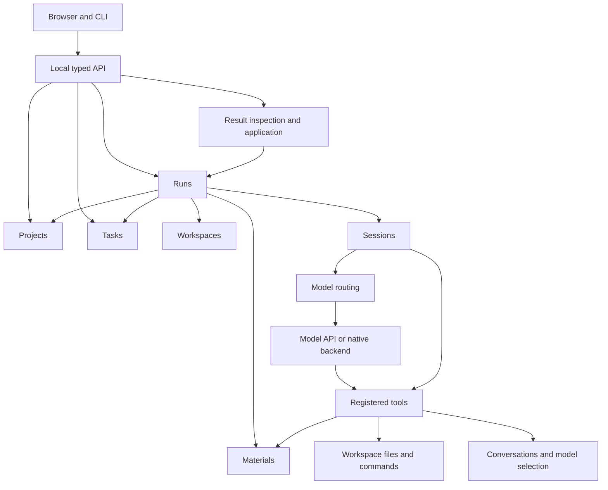

# Buro architecture

Status: 25 November 2026. The feature implementation in `modules/` follows the latest user decisions. The production daemon, browser and CLI still use the earlier implementation while their callers are being moved. Switching production and archiving its old state remain unfinished.

## Entities

| Entity | Owns |
| --- | --- |
| Project | A connected source directory |
| Task | User intent, independently of execution attempts |
| Run | One attempt, its workspace, baseline and final result |
| Session | Portable conversation, current model and execution access |
| Agent | Reusable instructions and optional tool selection |
| Model connection | Backend settings and a private credential |
| Material | A copied attachment and its available text representation |

Entities refer to one another by ID. There is no mutable whole-application snapshot. Removing a definition does not erase historical runs or conversations.

## Module boundaries

The application is one process composed from ordinary feature modules. Public interfaces are separate from implementations. Commands and queries are direct calls; notifications announce changes after persistence. An observer cannot roll back completed work or fail the producer.

Each module receives the public APIs and stores it uses. Filesystem, clocks, IDs and other ordinary implementation dependencies are imported locally. Composition does not require a plugin framework, workflow DSL or service per feature. Extensions can register tools, backends and context readers through the same contracts; module APIs can be extracted into plugins later.

## Execution

Starting a task creates an isolated workspace and a new linked Session. With the default base, existing source edits become its starting baseline. The source branch and index remain unchanged. Another Run in the same project can execute independently; only Git worktree bookkeeping is serialized.

A Session runs one model/tool loop. Agent names, model sizes and role labels never select special core behavior. Collaborators are ordinary sessions that can receive follow-up work and use explicitly selected models. Access follows the invocation, not its name. The agent chooses useful reviews and checks, iterates on feedback and decides when the task is finished. There is no universal reviewer, acceptance score, mandatory check list or final-answer grammar.

When the root agent finishes, the Run saves its result and stops remaining background collaborators before announcing completion. Unexpected tool faults cannot be hidden by a backend claiming success. Ordinary invalid arguments and unavailable tools return feedback to the agent.

A retry creates new Run, Session and workspace identities. It carries saved files and portable history, keeping the previous baseline and last selected model unless explicitly replaced. An action without a recorded outcome is described as unknown; it is never automatically replayed. Restart recovery marks abandoned work interrupted rather than restoring an exact internal step.

## Backends and history

`SessionBackend` can wrap a portable model provider or own a native process. HTTP transports receive model request data, not application state or filesystem responsibilities. Native dynamic tool calls use the same broker, access and history as model API tool calls.

Changing a model preserves the Session. Public messages have stable identities. Provider continuation is stored separately, keyed by Session, message and adapter revision, and is attached only to its owning adapter. It never appears in public notifications or model selectors. Request context is a bounded view of saved history; a large tool result cannot evict the current task.

The Codex backend uses an owned ephemeral native thread with portable conversation input. Its workspace effects go through registered Buro tools. Inherited external integrations are excluded from that controller; they can be provided explicitly as Buro tools. The installed client has been checked for startup and permission handling without generating a model turn; native tool exchange is also covered by a protocol fixture.

## Storage and settings

SQLite stores current records in feature-owned namespaces. JSON implements the same record contract. Activity is a separate diagnostic history, not the source needed to reconstruct application state. Record patches preserve unrelated concurrent changes; settings and credentials for a model connection form one atomic private record.

Configuration consists of application defaults and explicit Run overrides. Reusable agent descriptions are data, not another precedence or authorization hierarchy. Context readers use ordinary registration order, without a sealed startup catalog. Uploaded bytes are retained privately; models can read text ranges through tools. A retained image reference does not imply its pixels were analyzed.

## Boundaries and results

Validate untrusted input at transport, tool and storage boundaries. Internal code relies on its types. Access to workspace files and application-private data is enforced by the environment adapter. Process trees and conversations are joined before their resources close. Notifications and provisional text are not receipts for completed actions.

The local API authenticates UI and CLI clients before exposing state or dispatching commands. The credential stays in application-private storage; it is not obtained from an unauthenticated network endpoint. Model credentials and private adapter state are excluded from API views.

Result inspection preserves new/deleted files, binary contents and executable modes without staging the live workspace index. Combining a result with its source is a separate explicit action. It preserves unrelated source edits and does not require a generated commit or reviewer status. Callers can supply the inspected revision to avoid applying a newer view accidentally.

## Remaining production work

Move browser and CLI callers to the new API, retain optional preview/delivery features through ordinary module APIs, and then switch the daemon. Archive existing working state privately before creating the clean production database; repair archived Git worktree references as needed. Remove old execution implementations and API callers after the switch rather than adding compatibility overloads. Run end-to-end checks before restarting model comparisons.
