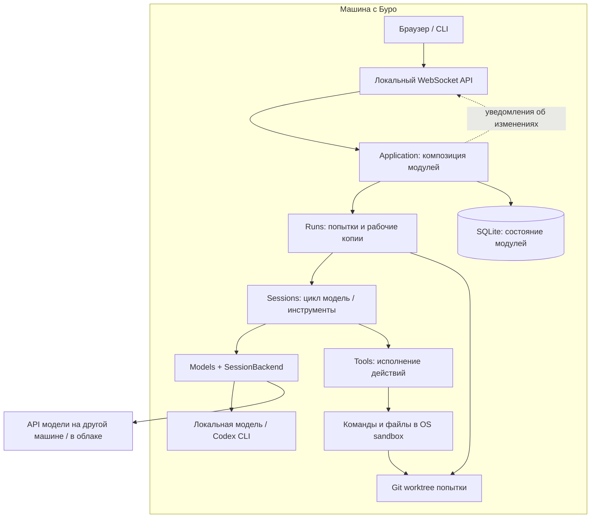
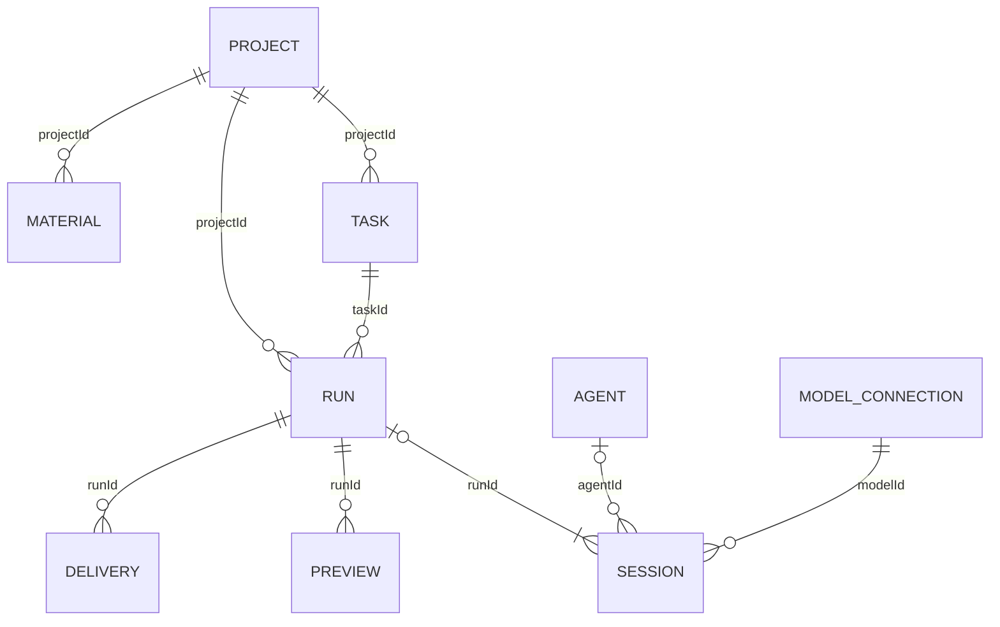
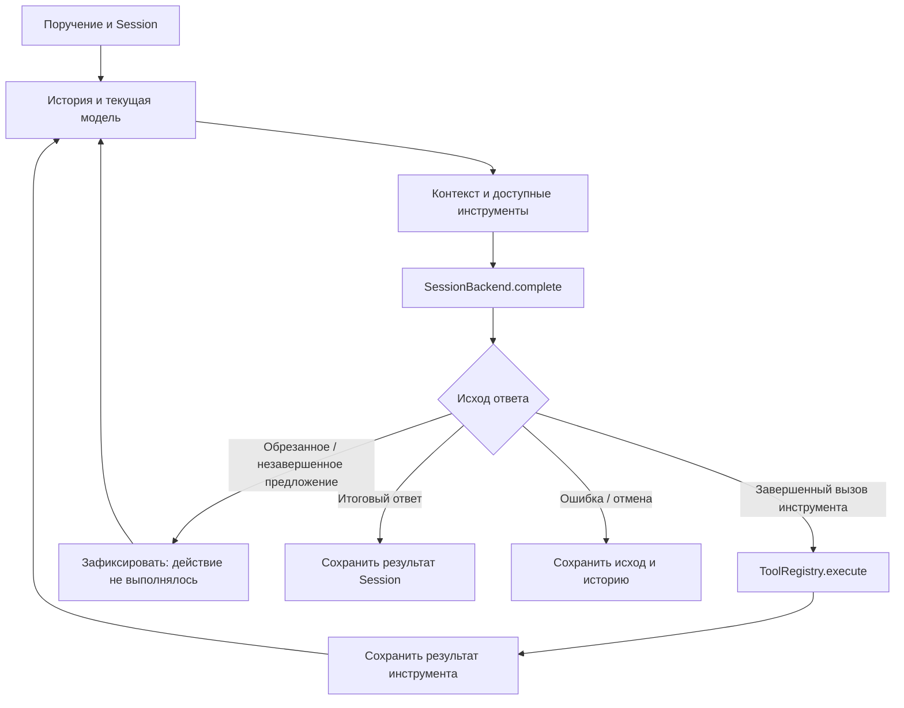
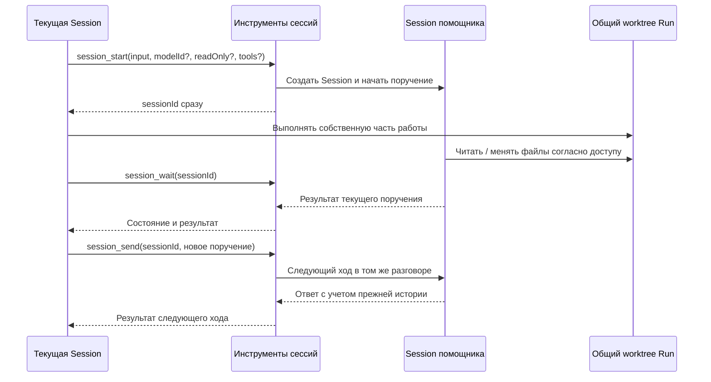
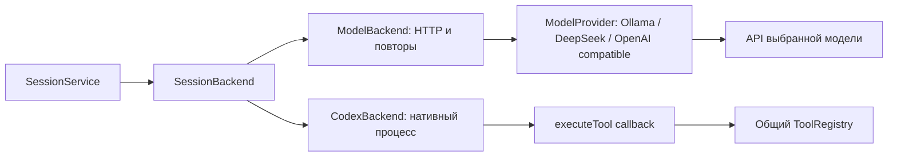
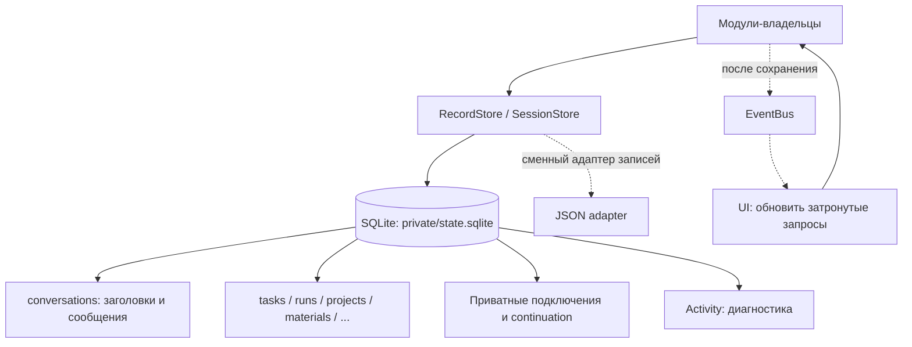
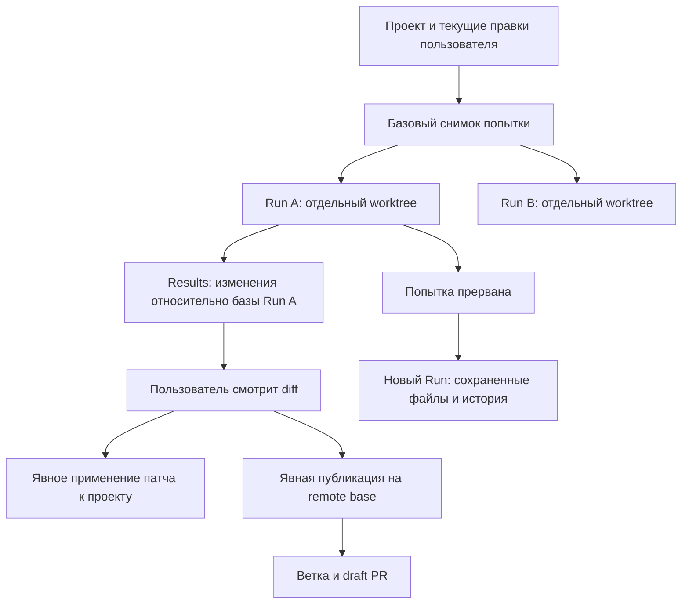

# Архитектура Буро

Буро — локальное рабочее пространство для задач, которые выполняют агенты. Пользователь задает результат, приложение создает отдельную попытку с рабочей копией, а агенты выбирают инструменты, модели и способ сотрудничества. Сервер отвечает за состояние, файлы и жизненный цикл исполнения; качество решения зависит от модели и выбранного ею процесса работы.

Документ сверяется с кодом на 25 ноября 2026 года. Схемы описывают текущую реализацию; будущие изменения отмечены отдельно. Другие проекты сравниваются по официальной документации, а не по качеству их моделей.

| Статус                   | Что сюда относится                                                                                                                |
| ------------------------ | --------------------------------------------------------------------------------------------------------------------------------- |
| Работает                 | Один сервер, независимые модули, SQLite, общий цикл сессий, смена моделей, помощники, Git worktrees, UI/CLI, preview и публикация |
| Выбрано, перенос впереди | FSD для UI, общая shared/, короткие имена файлов, публичные index.ts, алиасы и группы тестов                                      |
| Требует проверки         | Устойчивость командной работы небольших моделей и эффективность контекста на больших проектах                                     |

## 1. Общая схема

Один серверный процесс связывает модули обычными вызовами. Отдельные процессы создаются для команд, preview и нативного Codex. Удаленное размещение модели переносит туда генерацию; инструменты Буро продолжают работать на машине приложения.

`Application` собирает интерфейсы и закрывает ресурсы. Общего изменяемого объекта со всеми сущностями нет. Зависимости передаются через конструкторы. Точка сборки — [createApplication](modules/application/create-application.ts), набор возможностей — [Application](modules/application/application.ts).

API работает на loopback с аутентификацией. UI и CLI используют одни методы. Команды возвращают результат напрямую, уведомления сообщают, что перечитать. Подписчики не управляют исполнением задачи. См. [API](modules/api/server.ts), [контракт](modules/api/contract.ts), [EventBus](modules/events/event-bus.ts).

## 2. Сущности и связи

Это логические связи по идентификаторам, а не SQL `FOREIGN KEY`. Исторический Run может сохраняться после удаления задачи или подключения модели. Session может существовать отдельно от Run.

| Сущность         | Ответственность                                                          |
| ---------------- | ------------------------------------------------------------------------ |
| Project          | Подключенный исходный каталог                                            |
| Task             | Редактируемая цель и описание, независимо от попыток                     |
| Run              | Одна попытка, worktree, главная Session и итог                           |
| Session          | Разговор, выбранная модель, сообщения, доступ и результат                |
| Agent            | Необязательное сохраненное описание и инструкции; имя не дает привилегий |
| Model connection | Настройки транспорта и приватный ключ                                    |
| Material         | Копия вложения, метаданные и извлеченный текст                           |
| Preview          | Процесс предпросмотра и его порт                                         |
| Delivery         | Явно запрошенная публикация и ее исход                                   |

Одну Task можно запускать много раз. Session сохраняет идентичность при смене модели. `parentId` связывает помощника с родителем; `previousRunId` связывает попытки. Это разные отношения.

## 3. Цикл агента

Реализация — [SessionService](modules/sessions/session-service.ts). HTTP-адаптеры возвращают предложения инструментов; нативный backend может вызывать их через callback. Оба пути используют общий [ToolRegistry](modules/tools/tool-registry.ts).

Ответ сохраняется до исполнения его инструментов. Незавершенное предложение не превращается в действие. Ожидаемая ошибка инструмента возвращается модели как результат, с которым можно продолжить работу. Настраиваемые повторы временных HTTP-сбоев относятся к генерации, а не к повторному исполнению уже выполненной команды.

Модель выбирается для Run или Session и меняется на следующий запрос через `model_select`. Обязательного маршрутизатора по ролям нет. У отдельного вызова существует необязательный `SessionTurn.maxRequests`; по умолчанию он не задан. Это параметр вызывающего кода, а не оценка качества.

`completed` означает, что агент вернул результат. Корректность кода подтверждается тестами, ревью или ручной проверкой. Критерии синтетического бенчмарка не встроены в обычный Run. Фиксированных ролей, обязательного количества участников, порядка этапов и минимального балла в цикле нет.

## 4. Сотрудничество

Помощник — такая же Session с тем же циклом. Сохраненный Agent необязателен: поручение, инструкции и модель можно передать прямо при создании. Помощник наследует общий фон задачи, помеченный как справочная информация; текущее поручение передается отдельным сообщением. Полная история родителя автоматически не копируется.

Read-only наследуется, список инструментов может сужаться. Ожидание другой Session отслеживает циклические зависимости. Когда главная работа Run заканчивается, его фоновые Session останавливаются и присоединяются к завершению. См. [sessionTools](modules/agents/session-tools.ts) и [Sessions.wait](modules/sessions/session-service.ts).

Ревью — обычный цикл поручений: запросить независимый взгляд, получить замечания, исправить код, отправить новую версию на повторное чтение. Для этого не нужен отдельный workflow engine.

Свобода делегирования сама по себе не устраняет ошибки координации. В текущей диагностике Qwen 9B повторно делегировал одно поручение и многократно читал файлы. Прогон остановлен через 31,6 минуты: 9 помощников, 261 запрос. Влияние модели, контекста и описаний инструментов еще не разделено экспериментом; объяснять все только размером модели преждевременно.

Qwen 35B на той же версии кода завершил сценарий ревью с 8/8 проверок за 647,8 с: 7 помощников и 70 запросов. Результат корректен на этой задаче, но командная работа остается дорогой. Агрегаты обоих прогонов сохранены в [снимке измерений](docs/assets/architecture/rtx-sample.json); это отдельные эксперименты, не общий рейтинг моделей.

## 5. Backend, модель и контекст

[SessionBackend](modules/engines/backend.ts) отделяет цикл приложения от способа исполнения. [ModelProvider](agent/contracts/model.ts) — переносимый контракт моделей: сообщения, инструменты, ответ, usage и поток текста. В `agent/` находятся контракты и провайдеры; сам цикл с файлами и процессами пока остается в `modules/`.

История хранит сообщения, а не готовые запросы одному провайдеру. Перед запросом приложение присоединяет совместимое приватное продолжение адаптера и строит ограниченное представление контекста. Приватные данные привязаны к модели, ревизии backend и сообщению; чужое продолжение при смене модели не подставляется. Сохраненная история от проекции не меняется.

Размер контекста сейчас оценивается приближенно по сериализованным данным. Сохраняются инструкции, начальное и текущее поручения, целые обмены вызов/результат. Большие результаты инструментов могут сокращаться в представлении запроса. Точного токенизатора, семантического сжатия и индекса репозитория пока нет. См. [conversationContext](modules/sessions/context.ts), [ModelRegistry](modules/models/model-registry.ts).

## 6. Хранение и обновление UI

SQLite хранит записи модулей в отдельных namespaces одного файла. `RecordStore` возвращает отделенные значения и позволяет заменить реализацию хранения. Activity отделена от актуального состояния сущностей и не проигрывается для восстановления приложения.

Метаданные разговора и отдельные сообщения находятся в одном namespace: новая порция сообщений и заголовок коммитятся атомарно. Обычный ход дописывает новые сообщения, не переписывая прежние. Списки Session возвращают метаданные; `sessions.messages` читает ограниченную страницу по стабильным позициям. Перед исполнением выбранная история загружается в память порциями. JSON-адаптер сохраняет контракт, но физически переписывает файл namespace. См. [ConversationStore](modules/sessions/conversation-store.ts), [SqliteStorage](modules/storage/sqlite-storage.ts).

Ключи и приватное продолжение отсутствуют в публичных сообщениях и уведомлениях. Разделение логическое: сервер владеет обоими видами записей. Это локальное приложение одного пользователя; многопользовательской изоляции арендаторов нет.

UI подписывает запросы на изменения своей сущности и владельца. Серия уведомлений объединяется коротким окном без бесконечного откладывания. Изменение во время чтения вызывает еще одно чтение после ответа. При reconnect перечитываются записи; команды не переигрываются. Текст показывается отдельно как предварительный поток. См. [queryAffected](src/data/query-notifications.ts), [QuerySubscription](src/data/query-subscription.ts), [SessionView](src/features/runs/SessionView.tsx).

## 7. Файлы, результат и восстановление

При обычном старте текущие правки пользователя входят в базовый снимок Run. Результат — последующая разница агента. Создание worktree сериализует только Git bookkeeping репозитория; выполнение независимых Run остается параллельным.

Помощники одного Run разделяют файлы и должны согласовывать запись. Разные Run имеют разные worktrees. Worktree изолирует файлы попытки; OS sandbox отдельно ограничивает процесс. Команды и файловые инструменты используют macOS `sandbox-exec` или Linux `bubblewrap`; поддерживаемого command sandbox на Windows пока нет. Preview использует тот же адаптер команд, но имеет отдельный жизненный цикл.

Применение и публикация независимы от завершения Run. Публикация создает рабочую копию от удаленной базы и применяет только патч попытки. Описание PR пустое, пока пользователь не передаст его явно. См. [GitWorkspaces](modules/workspaces/git-workspaces.ts), [ResultService](modules/results/result-service.ts), [DeliveryService](modules/deliveries/delivery-service.ts).

При запуске сначала захватывается владение каталогом приложения, затем незавершенные операции помечаются прерванными. Продолжение создает новую попытку с сохраненными файлами и переносимой историей. Точный внутренний шаг не восстанавливается; действие с неизвестным внешним исходом автоматически не повторяется. Прерванная публикация сама заново не запускается.

## 8. Расширения и структура кода

| Контракт                     | Что заменяем или добавляем                | Определение                                                                                   |
| ---------------------------- | ----------------------------------------- | --------------------------------------------------------------------------------------------- |
| SessionBackend               | HTTP-модель или нативный агентный процесс | [backend.ts](modules/engines/backend.ts)                                                      |
| ModelTransport               | Создание backend из настроек подключения  | [model-configuration.ts](modules/models/model-configuration.ts)                               |
| Tool                         | Действие: определение, эффект, реализация | [tool.ts](modules/tools/tool.ts)                                                              |
| StorageEngine / SessionStore | Хранение записей и разговоров             | [record-store.ts](modules/storage/record-store.ts), [session.ts](modules/sessions/session.ts) |
| CommandSandbox               | Подготовка среды исполнения процесса      | [sandbox.ts](modules/commands/sandbox.ts)                                                     |
| MaterialLoader               | Чтение формата вложения                   | [material.ts](modules/materials/material.ts)                                                  |
| ResultPublisher              | Способ внешней публикации результата      | [delivery.ts](modules/deliveries/delivery.ts)                                                 |

Адаптеры собираются в `createApplication`, инструменты регистрируются через `Tools.register`. Замена backend не требует новой роли или ветки в цикле сессии. Установки, discovery и версионирования плагинов пока нет; интерфейсы дают границы для будущей упаковки модулей.

Серверные модули остаются небольшими и плоскими. Для UI выбраны FSD и Atomic Design внутри общих компонентов. Запланированы явные `index.ts`, алиасы и общая `shared/contracts` для DTO. Внутренние хранилища остаются у владельцев. Это еще не выполненный перенос; примеры будущих путей — в [правилах структуры](docs/STRUCTURE.md).

## 9. Близкие проекты

Сравниваются способы организации. Agents SDK — библиотека для построения систем; остальные строки описывают готовые инструменты или платформы. Таблица не утверждает отсутствие возможностей, не рассмотренных в источниках.

| Проект            | Основной подход                                                                                                                                                                                                                                                               | Что полезно для Буро                                                          |
| ----------------- | ----------------------------------------------------------------------------------------------------------------------------------------------------------------------------------------------------------------------------------------------------------------------------- | ----------------------------------------------------------------------------- |
| Буро              | Task / Run / Session, отдельный worktree попытки, один цикл, обычные вызовы модулей                                                                                                                                                                                           | Сохранять различие цели, попытки и разговора; менять адаптеры независимо      |
| OpenCode          | Серверный API сессий, моделей, инструментов и событий; профили primary/subagent/all и отдельные дочерние разговоры; пакеты и локальные плагины. [API](https://opencode.ai/docs/api), [агенты](https://opencode.ai/docs/agents/), [плагины](https://opencode.ai/docs/plugins/) | Четкие API возможностей, самостоятельный контекст помощника, точки расширения |
| OpenHands         | Agent Canvas отделен от SDK и Agent Server. SDK определяет разговоры, инструменты и workspaces; среда меняется между Local, Docker и RemoteAPI. [Компоненты](https://docs.openhands.dev/overview/introduction), [SDK](https://docs.openhands.dev/sdk/arch/overview)           | Отделять удаленное исполнение от клиента и модели, когда появится потребность |
| Aider             | Работа с Git-коммитами и undo; repo map отбирает важные символы графа зависимостей в пределах бюджета контекста. [Git](https://aider.chat/docs/git.html), [repo map](https://aider.chat/docs/repomap.html)                                                                    | Компактная карта кода и понятный результат изменений                          |
| OpenAI Agents SDK | Agent объединяет инструкции, модель и инструменты. Agents-as-tools оставляет управление у вызывающего агента, handoff передает разговор другому. [Композиция](https://openai.github.io/openai-agents-js/guides/agents/#composition-patterns)                                  | Различать поручение помощнику и передачу управления                           |

OpenCode описывает свежий контекст дочерних сессий. В Буро история помощника тоже отдельная, но общий фон Run наследуется. **Наша гипотеза:** проверить явный пакет «поручение + нужные факты + ожидаемый результат», чтобы уменьшить неоднозначность. Это не готовое исправление зацикливания. [Основание сравнения](https://opencode.ai/docs/agents/#modes).

Из OpenHands полезно разделение conversation и workspace; распределенная инфраструктура локальному приложению сейчас не требуется. Из Aider — адресная карта репозитория как дополнительная возможность. Из Agents SDK — различение вызова помощника и handoff; текущие `session_start` / `session_wait` ближе к первому варианту. Это наши проектные выводы из приведенных источников.

## 10. Производительность и наблюдаемость

Полное время включает загрузку модели, обработку контекста, генерацию, инструменты, запись истории и ожидание помощников. Параллельные Session делят заданную пропускную способность endpoint. Количество агентов и токены/с по отдельности не показывают скорость решения задачи.

| Один прогон обычной задачи | Проверки | Полное время | Серверная скорость генерации | Запросы |
| -------------------------- | -------- | ------------ | ---------------------------- | ------- |
| Qwen 3.5 9B Q4_K_M         | 8/8      | 65,1 с       | 54,5 токена/с                | 7       |
| Qwen 3.6 35B-A3B Q4_K_M    | 8/8      | 68,6 с       | 45,6 токена/с                | 7       |

Обе модели: thinking, RTX 3060 12 ГБ + 32 ГБ RAM, код `88fecc9`, fixture `synthetic-ready-queue-v1`, контекст 32 768, выходной лимит 8 192. Перед сценарием модель выгружается, поэтому полное время включает загрузку. Sampling одинаков и сохранен в [снимке измерений](docs/assets/architecture/rtx-sample.json).

Это единичные замеры небольшой задачи без помощников, без доверительных интервалов и общего рейтинга качества. Матрица пяти моделей еще не закончена. Серверная скорость — сумма output tokens / сумма `eval_duration` завершенных ответов. Все семь запросов каждой строки имеют тайминг и наблюдаемое приватное продолжение. Output tokens / полное время — другая метрика. Длительности Ollama переводятся из наносекунд в секунды. [Формат ответа](https://docs.ollama.com/api/chat#response-eval-duration).

Приватные отчеты остаются в игнорируемом `artifacts/model-evaluation/`. В Git сохранены только агрегаты и хеши кода, harness и fixture. График воспроизводится командой `uv run docs/assets/architecture/plot.py`. Более ранние проверки и их ограничения — в [Flash validation](docs/FLASH-VALIDATION-2026-11-25.md).

## 11. Дальнейшие изменения

| Область         | Следующий шаг                                                       | Ожидаемый результат                                |
| --------------- | ------------------------------------------------------------------- | -------------------------------------------------- |
| Структура кода  | Согласованный перенос папок, контрактов и импортов                  | Границы модулей видны без чтения всей реализации   |
| Координация     | Сравнить thinking-прогоны и изучить повторную делегацию             | Меньше лишних ходов при сохранении качества        |
| Контекст        | Проверить явную передачу фактов помощникам, затем карту репозитория | Меньше двусмысленных поручений и повторного чтения |
| Длинные истории | Измерять загрузку разговора в память и точность оценки контекста    | Наблюдаемая стоимость длинной Session              |
| Расширения      | Выносить модуль в пакет при реальном потребителе                    | Упаковка не меняет цикл исполнения                 |

Это направления развития, а не обязательные этапы каждого Run. Проверка архитектуры — выполнить реальную задачу, сохранить понятную историю, проверить изменения и получить применимый результат.

См. также: [запуск и CLI](README.md), [подключения моделей](docs/MODELS.md), [кодстайл](docs/CODE-STYLE.md), [состояние рефакторинга](docs/ARCHITECTURE-REFACTOR-2026-11-25.md).
