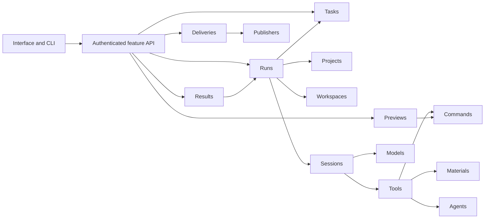

# Architecture

Buro is one server process composed from feature modules. Each module owns its records and exposes ordinary methods. Commands return results directly. Notifications announce changes for clients to refresh; they do not drive a workflow or restore state.

## Entities and ownership

| Entity | Owns |
| --- | --- |
| Project | A connected source directory |
| Task | User intent, editable independently of attempts |
| Run | One isolated attempt, workspace and root session ID |
| Session | Portable messages, shared background, selected model, explicit access and result |
| Agent | An optional reusable description and instructions |
| Model connection | Transport configuration and its private credential |
| Material | A retained file and optional extracted text |
| Preview | A foreground process with its own port and lifetime |
| Delivery | An explicit publication and its observed outcome |

SQLite stores current feature records in separate namespaces. A replaceable JSON implementation exposes the same record API. Records returned to callers are detached values. Diagnostic activity is separate from state and is never replayed to reconstruct it. Application-directory ownership is acquired before recovery.

Conversation headers and individual messages share a module-owned namespace so each append commits the header and new messages atomically. Normal execution does not rewrite earlier messages. Session lists return metadata; `sessions.messages` reads bounded chronological pages using stable positions. SQLite filters and indexes selections before deserializing records. The JSON reference adapter preserves the contract but still rewrites its namespace file. Existing histories are migrated once, preserving message IDs and private continuation records. Execution loads only the selected conversation, in pages, before projecting model context.

## Execution

`SessionService` contains an ordinary model/tool loop. A session may call tools, start collaborators, read their feedback, switch models and return a result. Shared work context is labeled as background; the current assignment stays in conversation messages. Session parent links describe collaboration, while a continued attempt is linked through its run. There are no reserved agent names, required role counts, fixed phase sequences, automatic review requirements or score thresholds.

HTTP transports and the native Codex adapter implement `SessionBackend`. All tool effects pass through the same broker. Private reasoning and adapter continuation are stored separately from portable public messages, keyed by model revision and message identity. Context projection does not alter saved history.

Commands own cancellable process groups and OS isolation. File tools use the same environment. Access settings are explicit and inherited by collaborators; a reusable description does not grant privileges. Preview processes use that command adapter, but their lifetime belongs to the application rather than a model turn.

## Results and recovery

Each run has a Git worktree. Initial user changes become its baseline. Results capture the delta without altering the live index. Applying a patch preserves unrelated source work. Publishing builds a new workspace on a remote base, applies only that delta, pushes a branch and creates a draft PR. The PR description is empty unless explicitly supplied.

After a process exit, running work is marked interrupted. Continuing creates a new attempt with the previous files and history, rather than repeating an internal step whose effects might already have happened. Publications are not automatically retried when their remote outcome may be uncertain.

## Extension boundaries

Composition is in `modules/application/create-application.ts`. Storage engines, model transports, tools, material loaders and result publishers are replaceable through their public interfaces. Feature code does not depend on a plugin container or frozen startup registry. An extension can later be packaged as a plugin while keeping these boundaries.

The browser shares the connection only. Each feature owns its queries, notification subscriptions and forms. Reads coalesce relevant changes on a bounded timer, apply in-flight responses and follow up if state changed during the read. Continuous preview output cannot indefinitely postpone refreshes or invalidate unrelated model/project queries. The transcript initially loads recent messages and can fetch earlier pages without losing live additions. Reconnection refreshes current records; failed commands are never automatically replayed. The CLI uses the same methods and external validation boundary.
