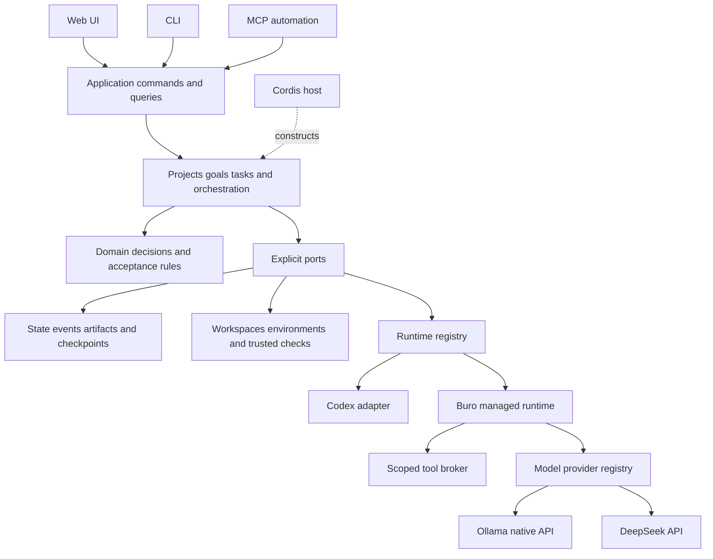

# Buro architecture

## Current refactor: 25 November 2026

The latest user decisions supersede the older design below. The new implementation lives in `modules/`. It is being integrated; the production daemon and UI still use the previous implementation until the application cutover is complete.

- Feature modules own their records and expose interfaces. Ordinary API calls execute work; detached notifications announce committed changes. Modules do not share a mutable application snapshot.
- `Task` is user intent, `Run` is an isolated attempt, and `Session` is a portable conversation. They refer to each other by ID.
- SQLite stores current state. JSON is an interchangeable storage implementation. Activity is diagnostic history, not a prerequisite for rebuilding state.
- One common model/tool loop serves arbitrary agent descriptions. Names and roles do not select privileged behavior. Reviews and tests are tools the agent can choose; completion has no mandatory universal acceptance gate.
- Each Run receives its own worktree. A retry creates new Run and Session identities, carrying saved files and public history; it does not replay an unfinished low-level action.
- Changing a model preserves the Session. Private provider continuation is stored separately and attached only to its owning model adapter and revision.
- Configuration consists of application defaults and explicit Run overrides. There is no project/scenario/role precedence hierarchy.
- The application remains one process. First-party features are ordinary modules, with public interfaces suitable for future extraction into plugins.

The new execution slice is covered by behavior tests using SQLite, JSON, portable model transports and actual Git worktrees. Application composition, global model configuration, sandboxed file/command tools, generic collaboration and a typed local WebSocket API are implemented. Connection settings and credentials are one atomic private record; API views and notifications exclude credentials and private continuation.

Remaining integration includes UI/CLI callers, result inspection/application, context attachments, native agent backends and the clean-state cutover. Production still starts the older application. Old runtime state must be preserved in a private archive before the production switch; unused implementations and obsolete API callers should then be removed rather than maintained through compatibility overloads.

## Previous design, retained during migration

Status: agreed implementation direction, 20 November 2026. [VISION.md](VISION.md) owns the product model. This document describes the target; [GOAL-EXECUTION-POC.md](GOAL-EXECUTION-POC.md) describes current execution.

The [22 November adaptive orchestration decision](docs/ADAPTIVE-ORCHESTRATION-2026-11-22.md) defines the implemented model-selected action loop, startup contributions and optional delegation, without a model-size workflow router. It preserves planning and independent acceptance, and distinguishes this implementation from the remaining persistence target.

## Architecture decision

Keep a TypeScript modular monolith with an independent core and Cordis composition. Buro owns a persistent scheduler, the coordinator's decision protocol, verification and acceptance. Existing agent clients connect through runtime adapters. Direct model APIs connect through a shared Buro-managed runtime and provider-specific transports.

Ollama and the DeepSeek model API are required in the first multi-provider milestone. Codex continues through its adapter. Claude, ACP and other providers are later integrations, not prerequisites. SQLite is a target storage adapter; its migration is a separate change from the first provider vertical slice.

## Boundaries

`core/` contains domain rules and application modules that receive explicit ports. Pure decision functions do not start processes or depend on clocks without injected values. Core does not import Cordis, Node, React, provider SDKs or native event payloads.

`protocol/` contains public commands, events, projections and schemas. A transport DTO is not the whole internal workflow object. `plugins/` composes trusted implementations through Cordis. `adapters/` owns platform and provider details. UI, CLI and external automation use the same application API and authorization rules.

Organize modules by responsibility: projects, goals/runs, tasks/orchestration, roles, context, runtime routing, verification, operator requests and results. Keep related code together without requiring an npm package or service for every module.

Cordis owns registration, dependency readiness and resource disposal. Its process-local notifications are separate from durable domain events. Persist a domain transition before publishing it. Unloading a runtime stops new assignments and drains or explicitly interrupts existing ones; production execution must not depend on hot reload.

## Domain ownership

| Entity          | Meaning                                                                               |
| --------------- | ------------------------------------------------------------------------------------- |
| Goal            | Versioned user intent, acceptance criteria and input selection.                       |
| Run             | One independent attempt to satisfy a goal, with its own base and worktree.            |
| Task            | Bounded objective, dependencies, allowed writes, required outputs and checks.         |
| Attempt         | A particular execution of a task, including retries or reassignment.                  |
| AgentSession    | Concrete role, runtime configuration, context and lifecycle for an assignment.        |
| RoleVersion     | Reusable instructions and skill requirements with provenance.                         |
| Evidence        | An observed result tied to input revision, workspace commit, command and environment. |
| OperatorRequest | A durable question or action request and the work it blocks.                          |

Buro IDs identify these entities. Native thread IDs are external references scoped to a runtime and client configuration. Role names and logical agent paths are display/navigation data rather than proof of identity or filesystem isolation.

A run snapshots its criteria, base commit and initial policy. Each session snapshots the role, client/provider/model selection and context version actually used. Plan revisions append decisions; they do not rewrite finished attempts. A clarification can invalidate dependent evidence while preserving unaffected work.

## Coordinator and scheduler

The coordinator proposes structured decisions: investigate, delegate, propose a role, verify, replan, ask the user or finish. The scheduler validates decisions, reserves resources and dispatches work. The acceptance service determines success from evidence and policy.

The coordinator can add a specialist after discovering a risk. It does not have to predict the entire team at launch. Role candidates remain within existing permissions; reusable promotion follows evaluation or explicit user action.

Buro starts worker sessions itself. Native subagents may become an optional optimization after their lifecycle and permissions can be mapped reliably. They are not required for cross-provider orchestration. An undeclared native child cannot silently become a trusted assignment just because its prompt resembles a role name.

Start with a small versioned decision schema and bounded graph edits. Reject cycles, invalid dependency references, unsupported tools, ownership violations and policy expansion. A rejected decision returns a concrete correction. Repeated failure causes validated replanning, another context/strategy or a genuine blocker; a lifetime retry quota exists only when explicitly configured.

## Runtime and provider contracts

| Port              | Responsibility                                                                      |
| ----------------- | ----------------------------------------------------------------------------------- |
| RuntimeRegistry   | Available clients, configuration revisions and probed capabilities.                 |
| AgentRuntime      | Create a session, execute a turn, cancel, observe state and recover when supported. |
| ModelProvider     | Model discovery, provider capabilities and streamed normalized responses.           |
| ToolBroker        | Validate and execute a scoped tool request with a durable action ID.                |
| ContextAssembler  | Build a bounded session input from permitted, versioned sources.                    |
| ResourceScheduler | Host, endpoint/model, project and run capacity.                                     |
| VerificationPort  | Execute trusted checks and return independently observed evidence.                  |
| StateStore        | Transactional state, events, command receipts and dispatch intents.                 |

The managed runtime implements AgentRuntime once. Ollama and DeepSeek implement ModelProvider separately. They share task execution and tool semantics, while preserving provider-specific request formats, streaming behavior and continuation state. [Provider integration](docs/PROVIDERS.md) owns these details.

Normalize lifecycle, tool calls, progress, usage and terminal outcomes at the adapter boundary. Keep raw wire payloads and private provider continuation outside domain events and normal exports. A text delta is not a transaction or proof that a task advanced.

Capabilities are attached to a concrete client/model/endpoint combination: structured decisions, tool calling, context capacity, streaming, cancellation and recovery mode. Native resume, Buro checkpoint continuation and starting a new session are distinct operations. A capability can be unavailable without making the whole client unusable for other roles.

## Managed tools

The initial tool set is repository read/search, bounded file edit/patch, scoped command execution and artifact access. Coordinator delegation and operator questions use the application decision protocol. Keep the exposed schema small for smaller models.

A model requests tools; the service executes them. Validate arguments, workspace identity, path scope, output bounds and cancellation before dispatch. Writes and commands use the existing execution environment; they do not gain a host bypass because an API provider lacks a native sandbox.

Acceptance checks run under service ownership. Their definitions and evidence cannot be silently replaced by worker edits. Reviewers use fresh read-only sessions and the actual goal, diff and check results. A final assistant message is never an acceptance receipt.

## Context and routing

Select models by task requirements, measured capability, data policy, availability and any explicit user quota. Start with explicit user-selected profiles; add adaptive routing based on evaluation results. Do not equate a role title with a permanent model choice.

The first model-selection increment gives each run a frozen worker pool. The coordinator proposes a runtime for a bounded assignment; a pure service resolver enforces the user's versioned Auto/Prefer/Fixed preference and the saved pool. Persist the canonical decision and reason with the plan, then persist its AgentSession before client dispatch. The router verifies that session against the saved decision rather than trusting an arbitrary runtime ID in an input. A role edited during planning requires a fresh decision; later edits do not change an accepted assignment. Initial coordinator and independent-review resources remain profile choices in this increment.

Support local-only and configured hybrid operation. Endpoint credentials and private settings belong to machine configuration; shared project profiles contain references and constraints. A provider fallback cannot cross the project's data boundary without prior authorization.

A remote GPU supplies a model HTTP API; repositories, tools, orchestration and acceptance stay on the Buro host. SSH tunnels are not part of the runtime contract. An Ollama connection at a literal private IP can be explicitly trusted as self-hosted for local-only work; cloud-backed models remain excluded. API connection edits use the shared application commands and become active after a service restart. A pending edit blocks new work using that connection while existing owned runs retain the active configuration. After restart, a historical route with a different configuration fails closed instead of silently moving to the new endpoint.

Project materials, goal inputs, session briefs and run outputs keep separate provenance. Build context views appropriate to actual model capacity, leaving space for tool results and completion; this is separate from an optional aggregate user quota. Provider-native continuation needed for correctness must be preserved privately even when it is not part of the human-readable brief.

## Parallelism and workspaces

Permit multiple runs for a project and a goal, each with its own base and worktree. Replace the current PROJECT_BUSY restriction with queueing and explicit capacity. Keep latest-run pointers as conveniences, not exclusive ownership of a goal's history.

Initially use one writer per run worktree with independent read-only tasks where useful. Add separate task worktrees and serialized integration only after measuring the benefit. Nonoverlapping file names alone do not prove semantic independence.

Limit inference separately from logical sessions. Several agents may share one local model sequentially. Endpoint capacity, local memory, heavy checks and native graphics can each constrain parallelism. A blocked native test should not stop unrelated ready tasks.

## Persistence and recovery

Persist task state, command receipt and dispatch intent before executing an external action. Give every tool action a stable Buro ID. Store tool results before continuing the model turn. On restart, reconcile actual process/workspace state before retrying an action whose outcome is unknown.

File state remains an initial adapter. Add bounded private session checkpoints and external action reconciliation without pretending that a JSON transcript alone provides exactly-once execution. SQLite can later commit state, events, outbox and receipts atomically behind StateStore. Large logs and provider checkpoints belong in separate private artifacts with versioned references.

Cancellation first records intent, then aborts provider requests, stops owned tool processes and releases resources after observation. Disconnecting a stream alone does not prove that remote inference stopped. Unknown outcomes remain visible and are not automatically repeated.

Closing the UI leaves the daemon responsible for work. Questions, answers and clarifications survive transport loss. Apply, PR and deployment effects remain separate from implementation acceptance and reconcile their own external state.

## First vertical slice

1. Normalize the existing Codex adapter and introduce RuntimeRegistry without changing accepted-result behavior.
2. Implement the managed runtime, small ToolBroker and fake-provider contract tests.
3. Add Ollama native API and DeepSeek API adapters in the same milestone, including their private continuation and capability handling.
4. Let Buro delegate between independently recorded managed/native sessions, run trusted checks and obtain fresh review.
5. Expose minimal resource profiles and inherited defaults, preserving work and action IDs on interruption. Expand into in-place overrides, queued runs, a general task graph and durable questions in the next orchestration slice.

The milestone is complete when a goal works through either direct provider without Codex, a mixed-provider goal works under Buro's scheduler, and failures/cancellation/recovery preserve honest evidence. Conservative interruption with saved work is acceptable before full automatic reconciliation. A general task graph, concurrent project runs and SQLite migration must not delay the first provider vertical slice. A chat response from each provider alone is insufficient.

## Later decisions

Claude and ACP adapters, DeepSeek Harness as an optional runtime, SQLite migration, parallel task writers, richer retrieval and distributed execution can follow the first verified slice. LangGraph remains an alternative if a focused comparison shows that it simplifies recovery; Temporal becomes relevant for multiple execution hosts. There must be one owner of workflow state rather than two competing schedulers.

## Selected execution and resource-policy decision

See [EXECUTION-DESIGN-DECISION-2026-11-21.md](docs/EXECUTION-DESIGN-DECISION-2026-11-21.md) for the chosen target and source inventory. Production v1 behavior is unchanged by this design document.

Separate UsageAccounting, optional user quota, provider request capacity, scheduling quantum and operation health. New-format runs default to no aggregate hard quota. A cooperative yield is a resumable scheduling event, not a failed goal; counters and operation IDs cannot reset at that boundary.

For clean-cutover activation, use one authoritative transactional project store for admission receipts, incremental counters, public Run projections, events and idempotency receipts. SQLite is the selected implementation behind StateStore; core decisions operate on a summary and the requested operation receipt rather than an ever-growing operation map. Large private histories and complete logs use paged immutable artifact references. No separate accounting database plus authoritative JSON summary or live dual writing.

This unreleased product needs no backward compatibility: use one clean execution contract, no old runtime/checkpoint resume or legacy strategy resolver. Archive prototype state before explicit cutover without deleting it; optionally reimport domain inputs, never old generated quota defaults or executable ledgers. New configuration distinguishes none/inherit/bounded. New-format runs retain configuration identity, durable receipts and recovery. Observation-only defaults are implemented and tested across the former request/tool/session/segment/ledger boundaries; see [the current cleanup and evidence](docs/DEFAULT-NONE-CLEANUP-2026-11-23.md). Permissions, trusted checks, fresh review and unknown-effect reconciliation remain mandatory.

[Private-project evaluation details removed.]

The selected four-package graph separates agent-contracts, agent-runtime, model-providers and agent-adapters. A managed backend and a Codex/external client adapter implement the same neutral AgentBackend; eligible backends may serve any role. Client names never select stronger authority or a different acceptance policy. Cordis composes trusted backend/provider/workflow contributions; durable run state remains owned by Buro, not by process-local plugin notifications.

Use an explicit effective autonomy policy: no default aggregate quotas, advisory planned task paths with strict opt-in, independent inference/writer capacity and typed wait/stop/continuation reasons. [AUTONOMY-POLICY-2026-11-21.md](docs/AUTONOMY-POLICY-2026-11-21.md) owns that target. Revision-bound acceptance and owning-run unknown-effect reconciliation precede package extraction or storage replacement.
