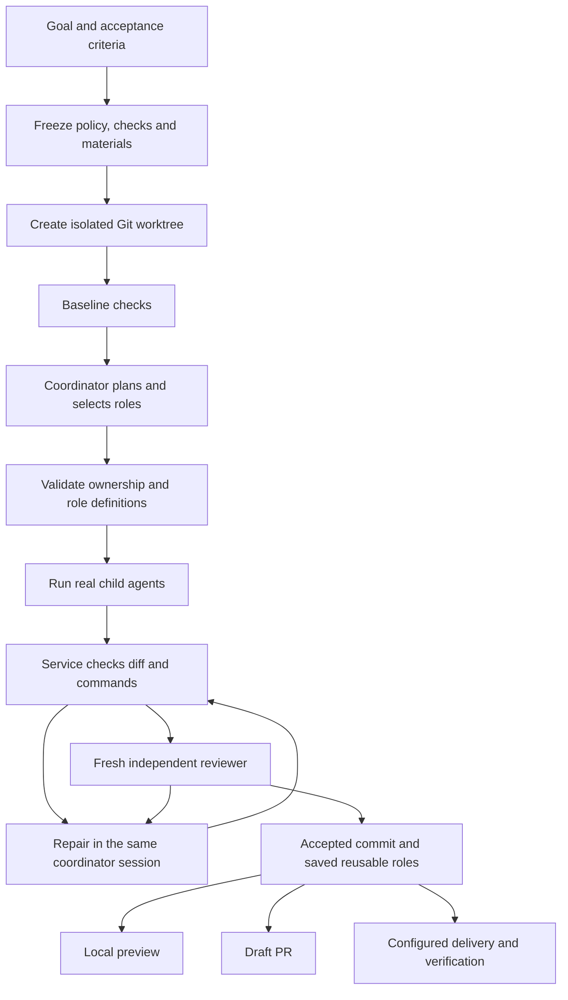

# Goal execution: architecture and evidence

Buro executes project goals through isolated workspaces, configured checks and independent review. Integration checks use synthetic fixtures rather than recorded local sessions.

The coordinator is not the acceptance authority. Actual worker lifecycle events, scope preservation, protected instructions, configured check results and reviewer approval are required. A successful message alone cannot accept a result. Coordinator/reviewer are supplied by the service; proposed worker roles have validated stable IDs and nonoverlapping paths. New reusable role definitions are saved only after acceptance.

The Codex adapter uses isolated stdio JSON-RPC sessions, completed-turn structured outputs and real lifecycle events. Trusted checks run outside editable agent scope. Runtime, checks and workspace ports are replaceable. Deterministic fixture tests verify integration without billing model calls; native adapter contract tests separately verify CLI behavior.

Workspace policies, roles and materials are snapshots. Independent goals start from the base branch; explicit parents start from an accepted commit. Source branches and uncommitted changes are preserved until an explicit apply action. Saved threads/worktrees support repair and check-only recovery.

Current behavior and limits are documented in [README](README.md), [recovery](RECOVERY.md) and [delivery](ONBOARDING-AND-DELIVERY.md).
