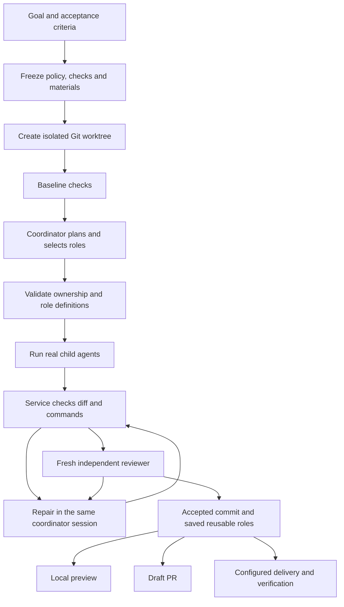

# Goal execution: architecture and evidence

This document describes the current Codex implementation. [ARCHITECTURE.md](ARCHITECTURE.md) defines the next execution model with Buro-owned delegation and direct Ollama/DeepSeek providers; [VISION.md](VISION.md) defines the product behavior.

Buro executes project goals through isolated workspaces, configured checks and independent review. Integration checks use synthetic fixtures rather than recorded local sessions.

The coordinator is not the acceptance authority. Actual worker lifecycle events, scope preservation, protected instructions, configured check results and reviewer approval are required. A successful message alone cannot accept a result. Coordinator/reviewer are supplied by the service; proposed worker roles have validated stable IDs and nonoverlapping paths. New reusable role definitions are saved only after acceptance.

The Codex adapter uses isolated stdio JSON-RPC sessions, completed-turn structured outputs and real lifecycle events. It normalizes native payloads before publishing typed activity to core. Execution and project research consume this contract; run projection is separate from execution decisions. A generic Cordis runtime plugin composes a process-local registry with an explicitly selected default route. Trusted checks run outside editable agent scope. Runtime, checks and workspace ports are replaceable. Deterministic fixture tests verify integration without billing model calls; native adapter contract tests separately verify CLI behavior.

Current limits include one unfinished run per project, a plan schema capped at two workers, Codex-owned child spawning and legacy role matching for native children. The registry currently selects one default runtime; per-session client/provider/model routing is not implemented. The next steps introduce Buro-owned assignments, a persistent task scheduler and managed provider sessions. See [implementation progress](docs/IMPLEMENTATION.md).

Workspace policies, roles and materials are snapshots. Independent goals start from the base branch; explicit parents start from an accepted commit. Source branches and uncommitted changes are preserved until an explicit apply action. Saved threads/worktrees support repair and check-only recovery.

Current behavior and limits are documented in [README](README.md), [recovery](RECOVERY.md) and [delivery](ONBOARDING-AND-DELIVERY.md).
