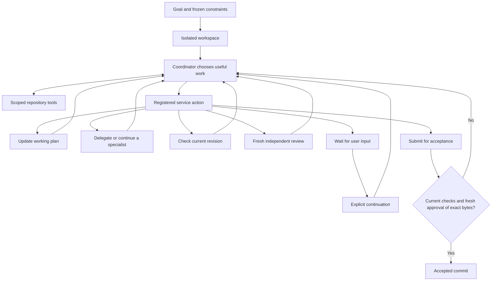

# Goal execution: architecture and evidence

Current implementation, 22 November 2026. [VISION.md](VISION.md) defines the product; [ARCHITECTURE.md](ARCHITECTURE.md) defines the full target. [Adaptive orchestration](docs/ADAPTIVE-ORCHESTRATION-2026-11-22.md) records the implementation decision and remaining limits.

Buro freezes a goal, policy, resources and material selection, prepares an isolated workspace and starts its coordinator. The coordinator can inspect and change sources using the existing backend tools, then choose a registered service action. Planning, delegation, integration and repair have no mandatory sequence. Native Codex and managed providers use the same structured action contract; Pi continues to own scheduling inside managed sessions.

The action catalog is a sealed startup contribution. Plugins receive bounded semantic operations, not a Run/store mutation callback. An invocation serializes and drains its started operations, revokes retained ports when its handler returns and cannot swallow an uncertain operation to continue. The admitted catalog identity is checked before dispatch and continuation. A plugin-provided `accepted` or `terminal` value never grants completion authority.

A working plan is a recorded, editable artifact; it grants no permissions. Each delegation commits its own immutable role/version/resource/path/task grant before opening a worker session. The team may grow after new findings, within the saved project allowance. Exact repeated assignments can resume their original worker when supported. Otherwise a new session preserves the logical role and known context explicitly. Unknown outcomes block retry or replacement.

Workers execute serially in the run worktree. Before/after observations detect forbidden changes and reversions. Managed repository tools also enforce scope before dispatch. Native execution retains its backend constraints and post-execution checks; native child observations cannot manufacture an assignment grant. Fully local profiles never silently route to cloud models.

Checks, review and finish are separate operations. Checks issue a host-owned receipt for the actual base/HEAD/index/tree and immutable verification view. Review uses a fresh read-only session on that view. Source changes invalidate prior evidence; Git identity changes require intervention. Finish rechecks receipts, worker grants/results, scope, protected check definitions, cancellation, unknown effects and the actual revision before checkpoint and final acceptance. The coordinator can repair and request new evidence; it cannot approve itself.

Stopped attempts retain their workspace and exact inherited assignment references. Task validity follows each assignment separately, so a changed goal invalidates old compact tasks without dropping newly delegated tasks for the revised goal. Check-only recovery needs no formal TeamPlan and runs fresh service verification. Repair continuation returns control to the coordinator. An explicit user question creates a genuine needs-attention stop.

Production still uses the sole File authority. The standalone SQL adapter implements the same delegation/continuation contracts on a fresh v9 format; production SQL routing and complete effect/history migration remain unfinished. Prototype formats have no compatibility or migration path. Lifetime request/tool/session/segment/history bounds remain; default-none is not implemented. `maxRepairs` is removed from production policy and UI because strategy is selected by the coordinator.

Deterministic tests exercise real File/SQL commands, routed managed sessions, injected Ollama/DeepSeek HTTP streams, immutable checks/review, plugin lifetimes and negative acceptance. A 16K injected Ollama test verifies context fit with the current six-action grammar, full goal/history and request accounting. These are protocol and controlled integration evidence, not live-model coding quality. Actual native/RTX quality and broader crash/install gates remain separate. See [implementation progress](docs/IMPLEMENTATION-PROGRESS-2026-11-21.md).

Accepted results still use the existing [preview and delivery](ONBOARDING-AND-DELIVERY.md) services. Original source branches stay unchanged until explicit application.
