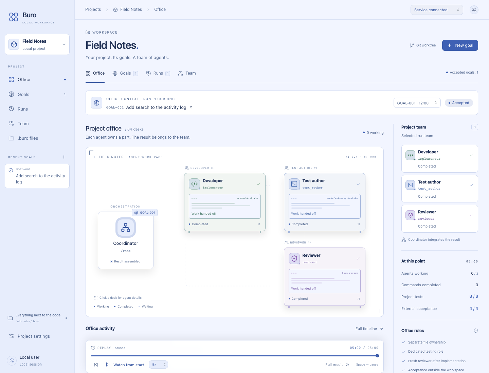
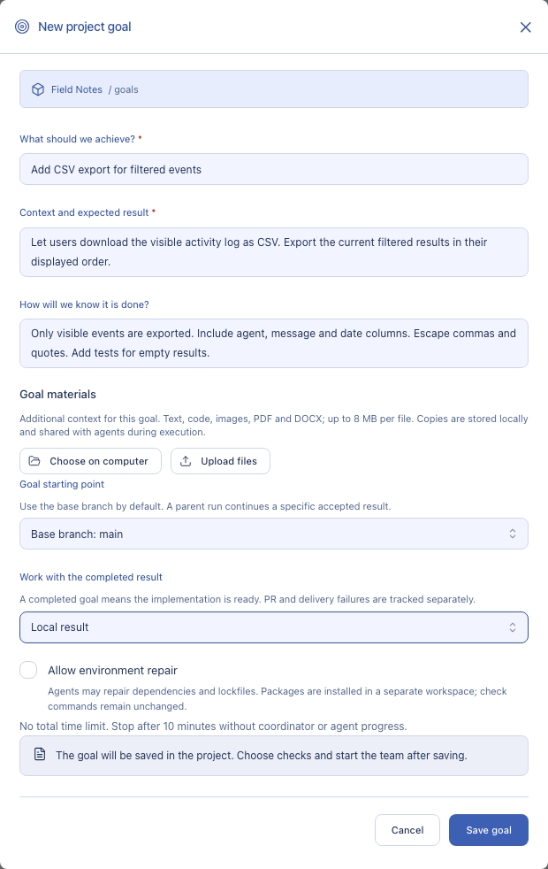
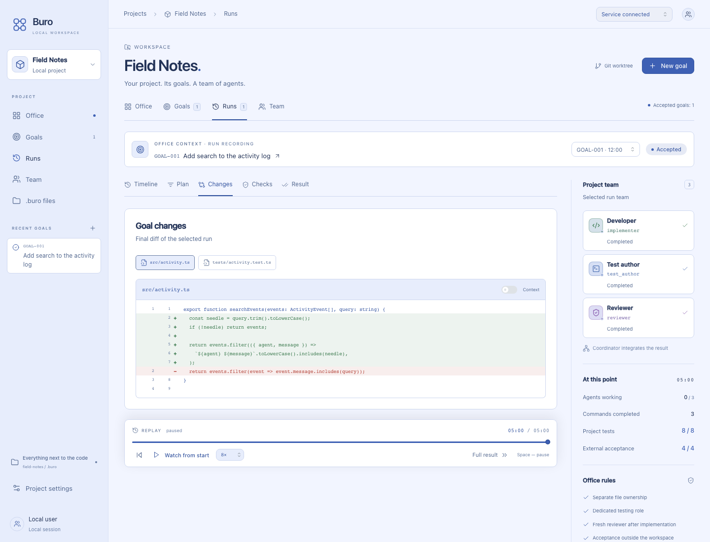
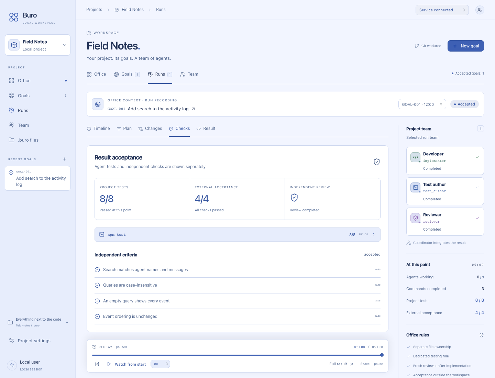

# Buro

<picture>
  <source media="(prefers-color-scheme: dark)" srcset="branding/logo-light.svg">
  
</picture>

Buro is a local workspace for automating coding goals with a coordinator, focused agent sessions and independent checks. Connect a Git repository and describe the outcome. Each goal keeps its plan, agent sessions, commands, diff and review in one place.

Work happens in a separate Git worktree. You can inspect the result, apply it to your branch, or have Buro open a draft PR. A coordinator plans the work and selects workers when needed; a separate reviewer checks the result.

Buro is still in development. It supports your installed Codex CLI and opt-in **Ollama and DeepSeek model API** connections through a Buro-managed runtime. The default remains Codex; configure [execution resources](docs/RESOURCES.md) to use direct model connections or a mixed team.

The [product vision](VISION.md), [target architecture](ARCHITECTURE.md) and [provider integration contract](docs/PROVIDERS.md) define the full direction. Buro owns worker dispatch, tools and verification; richer replanning and concurrent runs remain on the roadmap.

The [implementation sequence](docs/IMPLEMENTATION.md) tracks the transition from the existing route to that vision. The [controlled model comparison](docs/MODEL-COMPARISON-2026-11-21.md) records direct Codex, Buro and local/cloud model results and their current limits.

The [selected execution design](docs/EXECUTION-DESIGN-DECISION-2026-11-21.md) turns the [workflow research](docs/ARCHITECTURE-RESEARCH-2026-11-21.md) into a concrete plan: audited hidden constraints, optional quotas, a clean pre-release cutover and [reusable agent packages](docs/REUSABLE-AGENT-PACKAGES-2026-11-21.md).

The [full project architecture review](docs/PROJECT-ARCHITECTURE-REVIEW-2026-11-21.md) records fresh verification, reproduced gaps, SDK reuse choices and the revised implementation order. [Autonomy policy](docs/AUTONOMY-POLICY-2026-11-21.md) defines the target defaults: advisory file scope and optional strict scope are implemented; opt-in aggregate quotas and broader stop/continuation behavior remain planned.

[Implementation progress](docs/IMPLEMENTATION-PROGRESS-2026-11-21.md) distinguishes completed refactor steps and their checks from the remaining target design.



*Screenshots show the actual interface with a fictional project and sample run data.*

## Run locally

You need Node.js **24+**, npm, Git, and a configured execution route: authenticated Codex CLI, installed Ollama model, or DeepSeek API credentials. The default route requires Codex until changed. Connected repositories must have at least one commit. Native command execution uses macOS `sandbox-exec` or Linux `bubblewrap`; Docker is currently available for the native Codex route.

```sh
git clone https://github.com/buro-hq/buro.git
cd buro
npm ci
npm start
```

Open **http://127.0.0.1:4317**. `npm start` runs the local service and frontend together; Ctrl+C stops both. There is no packaged desktop app yet.

Draft PRs also need an authenticated GitHub CLI (`gh`) and a GitHub remote for the connected repository.

## Your first task

1. Open **Projects → Connect project** and select a Git repository.
2. Let Buro suggest the project setup, or enter it yourself. Review the base branch, allowed paths, protected files and check commands before saving.
3. Create a goal. Describe the change and how you will know it works. Attach relevant files or images if needed.
4. Choose the checks and start the run.
5. Read the diff, check results and review. Apply the result to your branch, keep it in the worktree, or use the configured PR or delivery action.

For example, a goal can ask for CSV export and specify which rows to include, how to escape values, and what to test:



Project setup research reads the repository and proposes settings. Saving a proposal does not install packages, start servers or deploy the project.

## What to use it for

- **Fix a bug with a known reproduction.** Attach the failing input or a short log. Ask for a regression test and keep the change within the affected module.
- **Add a small feature.** For example: “Search the activity log by agent name or message. Ignore case, keep event order, and show all events for an empty query.”
- **Refactor code with existing tests.** For example: “Move CSV parsing into a helper without changing the public API.” Run the existing checks against the result.
- **Continue a stopped task.** Add clarification to the saved goal, repair the same worktree, or rerun checks without starting implementation again. A new goal can also build on a completed parent run.

Keep a goal small enough to review as one change. Planned paths guide work by default; additional public files can change and are reported with the verified result. Project settings offer an explicit strict option and configure protected paths and acceptance checks.

## Inspect the result

The run view shows the plan, timeline, changed files, check output and reviewer findings. You can replay the saved history or open an individual agent's commands and messages.

Acceptance checks and fresh review use a separate read-only snapshot of the exact source tree to be saved. Checks that generate reports or build artifacts need output directories declared under **Writable check outputs** in project settings. Those outputs remain separate from source. Unsupported verification isolation stops explicitly rather than running an unconstrained host check.

| Read the diff | Inspect checks and review |
| --- | --- |
| [](docs/images/changes.png) | [](docs/images/checks.png) |

Applying a result is a separate action that checks the source branch and working tree. PR delivery and deployment follow the project settings. Deployment requires configured commands and verification; see [delivery setup](ONBOARDING-AND-DELIVERY.md).

## Files and saved work

Each connected repository stores its profile and local state in `.buro/`. Goals, roles, run history and worktrees survive closing the interface. The shared profile is `.buro/project.json`; runtime state, attachments and machine settings should stay out of Git.

Project materials are available to future goals. Goal attachments belong to that goal. Runs keep a snapshot of the materials they used. Text, code, images, PDF and DOCX are supported, with an **8 MiB per-file limit**. PDF/DOCX text extraction depends on tools available on the host; OCR is not included.

The interface supports **English and Russian**, five palettes, and light/dark/system modes. The default is **Cobalt light**. Appearance and language preferences are saved in the browser.

## CLI

The CLI uses the same local service as the interface:

```sh
npm run cli -- projects
npm run cli -- project connect /absolute/path/to/repository
PROJECT_ID=p-ID npm run cli -- goal create "Add search" "Search agent names and messages" "Ignore case and preserve order"
PROJECT_ID=p-ID npm run cli -- run start G-ID
PROJECT_ID=p-ID npm run cli -- run watch R-ID
```

Use the project and goal IDs returned by the preceding commands. See [development notes](docs/DEVELOPMENT.md) for service configuration and additional commands.

## Current limits

- Managed routes require a configured tool-capable model and native execution environment. Connection diagnostics are not proof of coding quality. Live-provider acceptance is tracked separately from deterministic tests.
- A run stops after 10 minutes without coordinator or child-agent progress. Checks, environment setup and delivery have their own timeouts.
- Worktrees, past attachments and dependency caches are retained. Automatic cleanup only removes stale temporary writes.
- This is a local tool. The service listens on loopback; it is not a hosted or shared team service.

## Development

```sh
npm test
npm run build
```

[Product vision](VISION.md) · [Target architecture](ARCHITECTURE.md) · [Execution resources](docs/RESOURCES.md) · [Providers](docs/PROVIDERS.md) · [Development and configuration](docs/DEVELOPMENT.md) · [Project setup](USER-PROJECTS.md) · [Current execution flow](GOAL-EXECUTION-POC.md) · [Recovery](RECOVERY.md) · [UI architecture](UI-ARCHITECTURE.md) · [Roadmap](ROADMAP.md) · [Branding](branding/README.md)

## License

[MIT](LICENSE) © 2026 Evgenii Bykovskikh.
