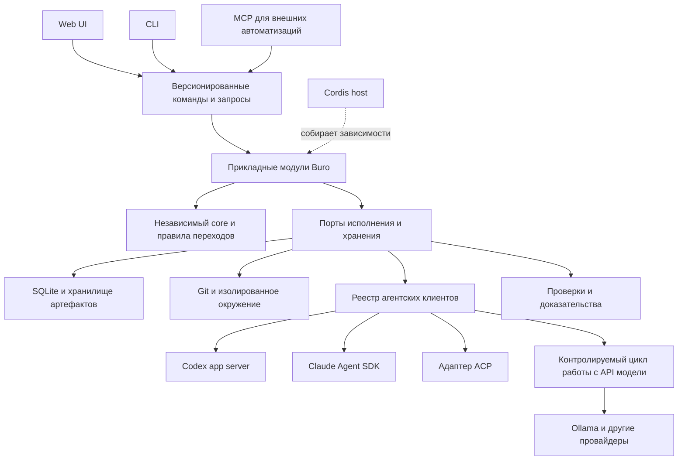

# Архитектура Buro для автономной команды агентов

20 ноября 2026 года

Результат исследования сохранён как исходное обоснование. Единое видение и последующий выбор первого среза закреплены в [VISION.md](../../VISION.md), [ARCHITECTURE.md](../../ARCHITECTURE.md) и [docs/PROVIDERS.md](../../docs/PROVIDERS.md): Ollama и API моделей DeepSeek входят в ближайший milestone; DeepSeek Harness остаётся референсом. Актуальные приоритеты находятся в [ROADMAP.md](../../ROADMAP.md).

Для текущего Buro рекомендую модульный монолит на TypeScript: независимый core, Cordis для композиции модулей, собственное управление задачами и несколькими агентскими клиентами, надёжное локальное хранение. Координатор предлагает действия и меняет состав команды по ходу работы; Buro проверяет эти решения, запускает сессии и принимает результат по доказательствам.

Главное изменение относительно текущей реализации — перенести управление работниками из родительского Codex в Buro. Тогда координатор на одном клиенте сможет назначить исполнителя на другом, а локальная модель получит короткую задачу с ограниченным контекстом. Качество обеспечивают контракты подзадач, проверка изменений, независимые тесты, ревью и ограниченный цикл исправления.

«Оптимальная» здесь означает наиболее подходящая отправная точка для локального продукта, существующего кода и обсуждённых сценариев. Превосходство команды небольших моделей над одиночным исполнителем нужно измерить на задачах проекта: опубликованные исследования не дают такой гарантии для наших моделей и репозиториев.

## Что уже есть в production коде

[Private-project evaluation details removed.]

| Область | Текущее устройство | Следствие для следующего этапа |
| --- | --- | --- |
| Независимость core | Core и protocol не импортируют Node, Cordis или React; направление зависимостей закреплено [boundary-тестом](./tests/boundaries.test.ts:22). | Эту границу сохранить. Переписывать ядро на другой язык не требуется. |
| Cordis | [Host](./plugins/host.ts:140) собирает сервисы и освобождает ресурсы. | Хорошая основа для модулей и адаптеров. |
| Выбор клиента | [AgentRuntime](./core/ports.ts:54) описывает сессии, но подключён один адаптер через `ctx.agentRuntime`. Вход запуска не содержит явного выбора client/provider/model. | Нужны реестр клиентов, маршрутизация и снимок выбранной конфигурации сессии. |
| Делегирование | [ExecutionService](./core/execution.ts:823) просит Codex использовать `spawn_agent`. | Командой фактически управляет конкретный harness, что мешает смешивать клиентов. |
| События | [Observe](./core/execution.ts:1125) разбирает Codex-специфичные `item/*` и `collabAgentToolCall`. | Преобразование нативных событий нужно закончить внутри адаптера. |
| Состав команды | План составляется перед исполнением; [схема](./protocol/execution.ts:26) содержит `.max(2)`. | Это ограничение схемы, а не адаптивный бюджет команды. Нужны последовательные решения о назначениях. |
| Параллельные запуски | [Start](./core/execution.ts:235) возвращает `PROJECT_BUSY`, если в проекте уже есть незавершённый запуск. | Нужны очередь, ограничение ресурсов и независимые worktree для запусков, в том числе одной цели. |
| Проверки | Сервис проверяет границы изменений, запускает команды, создаёт отдельного ревьюера и только после принятия сохраняет новые роли. | Это уже правильная основа качества. Её нужно расширять, а не переносить доверие к последнему сообщению координатора. |
| Восстановление | [Recover](./core/execution.ts:587) автоматически продолжает очередь, а активную работу помечает interrupted, сохраняя возможность продолжения. | Есть сохранность работы, но ещё нет восстановления каждого отдельного действия после сбоя. |
| Хранение | Состояние, события и receipts коммитятся атомарно; значимые изменения сохраняются дельтами. При этом [persist](./adapters/files/project-store.ts:115) записывает весь JSON. | Сохранить транзакционные гарантии, отделить горячее состояние от растущей истории. |

## Разделение ответственности



Core хранит смысл: что считается задачей, кто владеет изменениями, какие доказательства нужны, когда допустим переход состояния. Прикладные модули обращаются к портам для выполнения действий. Адаптеры знают о процессах, файлах, API и особенностях конкретного клиента. Cordis создаёт эти реализации и связывает их между собой.

Внутри core стоит различать чистые правила и прикладные сервисы с переданными портами. Сам факт отсутствия импортов Node не делает большой асинхронный сервис чистой функцией. Решение о следующем переходе должно проверяться без запуска процесса и без Cordis.

Начальный формат — один daemon и отдельные процессы клиентов/проверок. Микросервисы, Redis и кластер workflow-сервера пока не нужны. Независимые процессы для выполнения кода нужны уже сейчас: они решают вопросы изоляции и отмены, сохраняя простой способ установки продукта.

## Где использовать Cordis

Оставить Cordis на внешнем уровне: регистрация сервисов, объявление зависимостей, включение адаптеров, наблюдение за событиями и освобождение ресурсов. `Context` не передавать в domain и application API. Типы Cordis не должны становиться частью формата данных проекта.

Документация Cordis описывает сервисы, `inject`, типизированные события и обратимые эффекты. Это соответствует текущему способу композиции Buro. Сам upstream предупреждает о нестабильном API; установленную `4.0.0-rc.12` стоит сохранять закреплённой и обновлять после контрактных тестов. [Cordis](https://github.com/cordiverse/cordis), [primer, на который ссылается upstream](https://deepseek-harness.github.io/deepseek-harness/reference/cordis-primer).

Нужны два разных вида событий: процессные уведомления Cordis и сохранённые доменные факты. Уведомление о завершении плагина не заменяет запись о завершённой задаче. Доменное событие сначала фиксируется в хранилище, затем публикуется подписчикам через outbox — очередь уведомлений о уже сохранённых изменениях.

Вместо единственного `agentRuntime` предложены реестры `runtimes`, `modelProviders`, `environments`, `tools` и `verifiers`. Плагин регистрирует реализацию под стабильным ID; разные адаптеры существуют одновременно. При создании сессии Buro выбирает конкретную конфигурацию и сохраняет её версию.

Долгий запуск не должен зависеть от hot reload. Отключение адаптера сначала прекращает новые назначения, затем завершает или переводит активные сессии в явно сохранённое состояние. Нельзя выгрузить плагин и потерять сведения о том, завершилась ли команда. В production разумно начать без hot reload исполняющих модулей.

Роль агента — данные с инструкциями и требованиями к навыкам. Плагин — исполняемый код приложения. Координатор может предложить роль, но не устанавливать npm-пакет или загружать произвольный Cordis-плагин под видом нового специалиста.

## Модули и их границы

Разделять по ответственности, сохраняя одну кодовую базу. Отдельные npm-пакеты нужны только там, где действительно появляется независимое использование или распространение.

| Модуль | Что принадлежит ему | Основной контракт |
| --- | --- | --- |
| Projects | Корень репозитория, компоненты, найденные команды, контекст и версии профиля. | ProjectProfile и ProjectResearch |
| Goals and Runs | Намерение пользователя, критерии, несколько попыток и запусков одной цели. | Goal, Run, Attempt |
| Tasks and Orchestration | Граф подзадач, версии плана, назначения, отмена и перепланирование. | Task, Assignment, CoordinatorDecision |
| Roles | Шаблоны пользователя и кандидаты координатора, происхождение и версии инструкций. | RoleDefinition, RoleVersion |
| Context | Версии входных материалов, выбор релевантных фрагментов и краткое задание сессии. | ContextManifest, AgentBrief |
| Runtime Routing | Выбор client/provider/model по возможностям, лимитам и результатам проверки. | RuntimeRegistry, RuntimeCapabilities |
| Verification | Запуски команд, воспроизведение сценариев, findings, ревью и правила приёмки. | VerificationPlan, Evidence, AcceptanceDecision |
| Operator | Долговечные вопросы, ответы, уточнения, паузы и разрешения на конкретные действия. | OperatorRequest, OperatorAnswer |
| Artifacts and Results | Diff, отчёты, принятый commit, применение и отдельные действия доставки. | ArtifactRef, AcceptedResult, DeliveryAction |

В текущей структуре эти границы можно вводить внутри `core/` постепенно, начиная с разделения `execution.ts`. `plugins/` остаётся оболочкой сборки; `adapters/` реализует порты; `protocol/` содержит публичные DTO и схемы, а не весь внутренний изменяемый объект workflow.

## Сущности для динамической команды

Иерархия: Project → Goal → Run → Task → Attempt → AgentSession. Run имеет версионируемый граф задач. Один Task может получить новую попытку с другим клиентом или другой версией краткого задания, сохраняя связь с прежними доказательствами.

RoleDefinition отвечает на вопрос «какой специалист нужен». AgentSession — «кто выполняет конкретное назначение сейчас». Один шаблон роли может обслуживать несколько сессий. Их нельзя идентифицировать только названием роли или нативным `threadId`: Buro нужен собственный `sessionId`, а ID клиента хранится как внешняя ссылка.

Снимок запуска фиксирует исходную цель, критерии, разрешения, base commit и исходный профиль проверки. Каждая новая сессия фиксирует использованную версию роли, клиента, модели и контекста. Уточнение пользователя становится новым событием и версией решения; оно не переписывает историю уже выполненной работы.

Новая роль сначала является кандидатом этого запуска и видна в интерфейсе. Применить её можно в пределах уже разрешённых возможностей. Сохранение в библиотеку проекта происходит после проверки пользы и результата либо по явному действию пользователя. В текущем production-коде уже есть полезный принцип сохранения созданных ролей после принятия результата.

## Как координатор управляет работой

Координатор — LLM-компонент, который предлагает следующую порцию работы. Scheduler — программный компонент, который проверяет и исполняет допустимые решения. Разделение позволяет менять модель координатора, не отдавая ей управление транзакциями и правилами приёмки.

Набор решений должен быть небольшим: создать подзадачу, назначить подходящую роль, предложить новую роль, запросить материал, запустить доступную проверку, перепланировать незавершённую часть, задать вопрос пользователю или предложить завершение. Каждый ответ проходит schema-validation и проверку доменных ограничений.

План не фиксирует всю команду заранее. Buro начинает с разбора цели и контекста, затем выдаёт готовые к работе подзадачи. После нового факта координатор может добавить специалиста, закрыть ненужную задачу или поменять ещё не начатую часть графа. Завершённые результаты сохраняются; изменившиеся предпосылки делают связанные доказательства устаревшими.

```ts
// Эскиз будущего контракта, не реализованный API.
type TaskContract = {
  taskId: string;
  goalRevision: number;
  objective: string;
  inputRefs: { id: string; hash: string }[];
  dependencies: string[];
  allowedPaths: string[];
  expectedArtifacts: string[];
  verificationIds: string[];
  budget: { maxAttempts: number; maxInputTokens: number };
};

type CoordinatorDecision =
  | { kind: 'delegate'; task: TaskContract; roleId: string }
  | { kind: 'propose-role'; title: string; instructions: string; reason: string }
  | { kind: 'verify'; taskId: string; verificationIds: string[] }
  | { kind: 'ask-user'; question: string; affectedTaskIds: string[] }
  | { kind: 'replan'; reason: string; affectedTaskIds: string[] }
  | { kind: 'finish'; artifactIds: string[] };
```

`finish` означает предложение завершить цель. Успех подтверждает Buro после проверок и ревью. CoordinatorDecision не может изменить критерии, снять ограничения или объявить невыполненную команду успешной.

Весь граф задач не обязан быть активен одновременно. Небольшая цель получает одного исполнителя и нужную проверку. Дополнительная специализация появляется при обнаружении риска, независимой части работы или дефицита компетенций.

## Клиент, провайдер и модель

Это разные уровни настройки:

| Понятие | Пример | Что оно определяет |
| --- | --- | --- |
| Агентский клиент или harness | Codex, Claude Agent SDK, ACP-агент, собственный runner Buro | Цикл работы агента, инструменты, события, сессии. |
| Провайдер | API облачной модели или локальный inference-сервер | Транспорт запросов, авторизацию и лимиты. |
| Модель | Конкретная модель и её параметры | Возможности и стоимость одного вызова. |
| Среда исполнения | Native sandbox или контейнер | Где запускаются команды и какие ресурсы доступны. |

Для Codex сохранить текущий app-server adapter: официальный интерфейс предоставляет threads, turns, поток событий и управление ходом выполнения. Для Claude рассматривать Agent SDK как отдельный harness, а не как взаимозаменяемый HTTP endpoint модели. Для совместимых клиентов добавить ACP adapter. [Codex App Server](https://developers.openai.com/codex/app-server), [Claude Agent SDK](https://code.claude.com/docs/en/agent-sdk/overview).

ACP полезен как общий транспорт, но наличие протокола не означает равенства возможностей. Например, загрузка истории и восстановление сессии без воспроизведения истории — разные возможности, которые агент объявляет отдельно. Нашу историю и состояние Run нужно хранить независимо от истории конкретного клиента. [ACP Session Setup](https://agentclientprotocol.com/protocol/v1/session-setup).

Перед включением клиента проводить capability probe: структурированный результат, поток событий, прерывание, возобновление, восстановление истории, внешние инструменты и фактически обеспечиваемая изоляция. Проверять комбинацию «версия клиента + модель + endpoint», а не один раз название продукта. Нативные subagents остаются необязательной оптимизацией; Buro должен уметь запустить работников сам.

Для локального API нужен отдельный небольшой runner: ограниченный набор инструментов, контролируемый цикл вызовов, отмена, лимиты и валидация результата. Это полноценная работа по созданию harness, её нельзя заменить вызовом `chat()`. Поддержка JSON schema помогает получить нужную форму ответа, но не доказывает истинность полей. [Ollama Structured Outputs](https://docs.ollama.com/capabilities/structured-outputs).

Нативные сообщения адаптер превращает в общий discriminated union: SessionStarted, TaskProgress, ToolRequested, ToolCompleted, SessionFinished, SessionFailed. Непрозрачный raw event можно сохранять отдельно для диагностики; core не должен ветвиться по Codex `item.type` или передавать `params: any` дальше.

## Качество кода на небольших моделях

Рабочая гипотеза: ограничения задачи и хорошие внешние проверки позволяют небольшой модели надёжнее справляться с посильной частью изменения. Из этого не следует, что любое число слабых моделей заменит сильного исполнителя на задаче, которую они не способны понять.

Исследование Scaling Agent Systems связывает эффект команды со структурой задачи и накладными расходами координации; в его наборе есть как выигрыши, так и ухудшения. Исследование отказов MAS выделяет проблемы спецификации, согласованности агентов и проверки завершения. Это аргументы в пользу управляемой команды и измерений, а не универсальная оценка качества нашего coding-продукта. [Scaling Agent Systems](https://arxiv.org/html/2512.08296v1), [Why Do Multi-Agent LLM Systems Fail](https://arxiv.org/html/2503.13657v1).

Краткое задание работнику должно содержать конкретную цель, критерии, нужные символы и файлы, ограничения, разрешённые инструменты и ожидаемый артефакт. Вместо полной переписки команды — ссылки на факты и принятые решения. Контекст измерять в токенах выбранной модели с резервом для ответа и инструментов; лимит в символах из прототипа для production недостаточен.

Начать с поиска по именам, содержимому, импортам и символам. Векторное хранилище добавлять после сравнения качества поиска на реальных задачах. Материалы разделять на общие входы проекта, входы цели, снимки контекста сессии и результаты конкретной попытки. Для каждого фрагмента сохранять источник и версию.

Автор изменения и проверяющий работают в разных сессиях. Проверяющий получает исходную цель, критерии, настоящий diff и результаты команд; ему не нужно доверять утверждению автора, что всё готово. Другая модель может повысить разнообразие проверки, но обязательной гарантией качества не является.

Перед принятием результата нужна цепочка: исходная проверка → целевые тесты → проверки интегрированного изменения → независимое ревью → исправления по конкретным findings. Проверять не только зелёный exit code, но и то, что команда действительно покрывает изменённый сценарий. Новые и изменённые тесты также требуют ревью; защищённые правила приёмки нельзя незаметно ослабить.

Повторять попытку стоит при новом полезном действии: уточнённом задании, исправлении конкретной ошибки, другом способе проверки или разрешённом переключении клиента. Одинаковые failures, повторные невалидные ответы и отсутствие новых артефактов должны приводить к ограничению цикла. Самооценка уверенности модели не заменяет эти сигналы.

## Параллельность и работа с Git

Количество целей, число логических агентов и число одновременно работающих inference-запросов — разные лимиты. Восемь ролей могут выполняться последовательно на одной локальной модели. Ollama связывает параллельные запросы с дополнительной памятью контекста; scheduler должен учитывать лимит endpoint, память и ограничения тяжёлых проверок. [Ollama FAQ](https://docs.ollama.com/faq#how-does-ollama-handle-concurrent-requests).

Ввести общие лимиты host, endpoint/model, проекта и запуска, а также отдельный лимит native UI/GPU-проверок. Начальные значения выбирать консервативно и корректировать по измерениям; фиксированное число работников в JSON schema заменить бюджетной политикой.

Независимые Run всегда получают разные worktree и зафиксированные base commit. Для первой реализации внутри одного Run достаточно одного писателя и нескольких читателей: это проще проверять, чем совместное редактирование несколькими клиентами.

Настоящие параллельные писатели — следующий режим: отдельные task worktree, договорённости о границах файлов, известная база patch и последовательная интеграция сервисом. Непересекающиеся файлы ещё не гарантируют независимость: задачи могут менять общий контракт, зависимости или генерацию. После интеграции нужны повторные проверки результата в общей рабочей копии.

Две ветки одной цели не должны незаметно делить рабочую копию. Это отдельные Run, даже если пользователь сравнивает их в одной полосе запусков. Зависимая цель должна ссылаться на конкретный принятый результат или явно выбранный commit, а не на изменяемую «последнюю ветку».

## Надёжное исполнение и хранение

Целевое хранение для большого числа задач — SQLite через существующий порт Store. В одной транзакции сохранять переход состояния, доменные события, receipt команды и intent внешнего действия. Полные stdout, изображения и большие diff хранить отдельными артефактами с content hash. Токеновые дельты не превращать в отдельные транзакции; текущий фильтр production-событий уже проводит полезное различие.

SQLite WAL подходит локальному daemon с одним владельцем записи; он допускает совместную работу читателей с писателем, но не превращает базу в распределённую и не подходит для обычного размещения WAL на сетевом filesystem. Проектное состояние можно держать в `.buro/state.sqlite`, а конфигурации машинных клиентов и секреты — отдельно от переносимого профиля. [SQLite WAL](https://sqlite.org/wal.html).

Host управляет общими ресурсами и восстанавливает занятые слоты по сохранённым lease и наблюдаемым процессам. Согласование файлов, Git и процессов не является одной SQL-транзакцией. Перед запуском записывается intent с operationId; после действия — наблюдаемый результат. При сбое между ними recovery сверяет реальное состояние, затем завершает либо явно помечает неопределённость. Слепой повтор может запустить вторую команду или создать второй PR.

Для каждого Task нужны Attempt, lease, состояние dispatch и ссылка на сессию. После рестарта Buro различает: задача ещё не запускалась; клиент доступен для reattach; действие завершилось, но receipt не записан; состояние неизвестно. Отмена означает сначала cancel_requested, затем подтверждённую остановку либо видимый остаточный процесс.

Живость процесса, активное выполнение команды и полезный прогресс — разные сигналы. Heartbeat продлевает lease, но не доказывает продвижение задачи. Для исправлений нужны отдельные ограничения повторов и отсутствия новых результатов; для команды — собственный timeout. Нельзя бесконечно продлевать работу только потому, что модель продолжает писать сообщения.

При большом числе целей клиент получает страницы списка и изменения после sequence/cursor, а не полный проект на каждое событие. Офис, лента и таймлайн — разные проекции одной сохранённой истории. Полные логи загружаются по запросу; UI не восстанавливает бизнес-состояние из текста сообщений модели.

Миграция JSON → SQLite должна сохранять ID, последовательности событий, receipts и ссылки на worktree, иметь резервную копию и проверку эквивалентности read-model. Смену хранилища не стоит объединять с полной сменой модели оркестрации в один рискованный шаг.

## Автоматизация и вмешательство пользователя

Профиль проекта автоматически формируется из найденных конфигураций, документации и реальных проб окружения. Для каждого вывода нужны источник и состояние: найдено, предложено, разрешено политикой, проверено выполнением. Найденная строка `test` не означает, что тесты доступны или достаточны.

Настройки наследуются от workspace к проекту и цели; отдельное назначение может сужать их. Основной пользовательский ввод — результат и ограничения. Стек, команды и роли доступны для уточнения по месту. Пользователь может закрепить нужного специалиста, изменить правила новых задач или направить текущую работу.

[Private-project evaluation details removed.]

Статусы исполнения и доставки разделяются. Принятый код может ждать применения или публикации. «Нужна помощь», «проверка недоступна», «не хватает доказательства» и «код не прошёл тест» — разные ситуации с разными следующими действиями.

## MCP и внешний поток целей

MCP adapter обращается к той же application API, что UI и CLI. Для первой версии достаточно create/update goal, start/read/cancel run и answer operator request. Создание цели с start=true должно возвращать устойчивый ID без ожидания всей реализации; повтор с тем же application idempotency key не создаёт вторую цель.

MCP Tools описывает вызовы внешних инструментов. Расширение MCP Tasks добавляет долгие операции с durable handle и запросами входных данных. Его можно поддержать после согласования capabilities; для клиентов без расширения оставить явные create/status/cancel tools. MCP-совместимость не заменяет внутренний scheduler и не означает поддержку native agent sessions. [MCP Tools](https://modelcontextprotocol.io/specification/2026-07-28/server/tools), [MCP Tasks](https://modelcontextprotocol.io/extensions/tasks/overview).

Входящий пакет из десятков целей проходит валидацию проекта, дедупликацию, лимиты очереди и принятую политику запуска. Scheduler может дать координатору предложить группы и зависимости, но не изменять смысл входных целей молча. UI показывает те же сохранённые задачи и события, что доступны через API.

## Сравнение архитектурных вариантов

| Вариант | Сильная сторона | Цена для Buro | Выбор сейчас |
| --- | --- | --- | --- |
| Текущий core + Cordis + сохраняемый scheduler | Сохраняет продуктовую модель, локальную установку и существующие адаптеры. | Придётся аккуратно реализовать dispatch, recovery и тесты сбоев. | Рекомендую как основную архитектуру, начиная с узкого поддерживаемого протокола действий. |
| LangGraph JS | Готовые checkpoints, interrupts и восстановление графа. | Нужны свои Git, проверки, runtime adapters и модель артефактов; появляется ещё одна модель состояния. | Кандидат для небольшого сравнительного spike, если собственный recovery начинает разрастаться. Не добавлять одновременно два владельца workflow. |
| Temporal | Сильная модель долговечных workflow и replay. | Дополнительный сервис, операции и требования к программированию replay. | Рассматривать при переходе к нескольким execution-host и общей облачной очереди. |
| DeepSeek Harness как основа всего Buro | Глубокая заменяемость частей agent loop и Cordis-плагины. | Модель сессий/harness отличается от наших Goal/Run/Acceptance; upstream активно меняется. | Использовать как референс и возможный дополнительный runtime через адаптер, не делать заменой domain core без отдельного доказательства выгоды. |

LangGraph действительно сохраняет состояние графа и незавершённые шаги; это полезная возможность, но она не доказывает правильность бизнес-переходов. Temporal отделяет replay workflow от внешних действий в Activities. Оба подхода подтверждают необходимость явной границы между решением и side effect. [LangGraph Checkpointers](https://docs.langchain.com/oss/javascript/langgraph/checkpointers), [Temporal Workflows](https://docs.temporal.io/workflows).

DeepSeek Harness показывает, насколько далеко можно провести заменяемость сервисов, инструментов и agent loop через Cordis. У Buro другая центральная ответственность: завершённая работа в пользовательском проекте с воспроизводимой приёмкой. Поэтому заменяемость исполнительных механизмов стоит брать как принцип, сохраняя небольшой явный набор доменных инвариантов. [Harness Architecture](https://github.com/deepseek-ai/deepseek-harness/blob/master/docs/architecture.md). README Harness отдельно обозначает developer preview и возможность несовместимых изменений. [DeepSeek Harness](https://github.com/deepseek-ai/deepseek-harness).

## Проверка архитектуры на двух проектах

[Private-project evaluation details removed.]

Срез «частичный результат после отмены» начинается с воспроизведения перехода status → отображение. Координатор выясняет, требуется ли менять контракт сессии, затем создаёт задачи по main/IPC и интерфейсу. Тестировщик получает отдельные сценарии отмены до первого сегмента, после сегментов и при повторном запуске. При необходимости появляется специалист по сохранности данных. Ручные правки становятся отдельным проверяемым инвариантом.

Срез «очередь локальных расшифровок» проверяет scheduler: отдельные состояния waiting/running/cancel_requested, ограничение тяжёлых процессов и освобождение слота после ошибки. Независимый тест проверяет гонки fake-engine, а не полагается на сообщение агента об успехе.

Срез SRT/VTT подходит небольшой модели: чистые formatter-функции, короткий контракт, golden-файлы и независимая проверка граничных таймкодов. Он может обойтись меньшей командой, чем изменение lifecycle сессий.

[Private-project evaluation details removed.]

Срез «справка в дневнике» разделяется на проверку источников, игровую модель и Fabric-интерфейс. Координатор подключает нативного специалиста после определения границы UI. Команды Java/Gradle выбираются из профиля этого проекта; Node-команды не наследуются от Buro.

Core-проверки могут выполняться в доступном локальном окружении. Нативный клиент требует графики; server smoke имеет свои предпосылки. Если их нет, Buro сохраняет частично собранные доказательства и конкретный запрос окружения, а не заменяет тест mock-результатом. Исполнение JAR и публикация остаются отдельными результатами и действиями.

Сюжетное продолжение First Light — пример вмешательства пользователя: автоматизировать исследование состояний и предложение небольшого среза можно, а выбирать за владельца содержание истории и награды не нужно. Независимые задачи при этом могут продолжаться.

## Как доказать пользу команды небольших моделей

Из 16 целей подготовить воспроизводимые подзадачи с фиксированными исходными commit и отдельной приёмкой. Часть сценариев уже работает и подходит для регрессии, часть — новые функции или продуктовые идеи. Сначала определить, какой именно diff и результат считаются правильными; большие идеи не превращать в один непрозрачный benchmark.

Сравнить: небольшой одиночный исполнитель; тот же исполнитель с независимой проверкой; адаптивная команда небольших моделей; более сильный одиночный исполнитель как ориентир, если он доступен. Для сравнения нужны одинаковые лимиты бюджета, инструменты, данные и несколько повторений. Отдельно исследовать выигрыш параллельности и выигрыш качества — это разные метрики.

Собирать долю результатов, прошедших скрытые критерии и ручное ревью, количество регрессий, стоимость принятого изменения, время до результата, токены координации, повторные действия после сбоев и число вмешательств пользователя. Для локальных моделей дополнительно измерять память и конкуренцию процессов.

Тесты, которыми проверяется итог, не должны генерироваться тем же исполнителем как единственный oracle. Оставить заранее подготовленные граничные случаи и отдельную человеческую оценку diff. Настройка роли не должна обучаться на всех будущих проверочных задачах.

Доказательство пользы — больше корректных принятых изменений при сопоставимом бюджете либо сопоставимое качество при меньшей стоимости. Число сессий, длина обсуждения и одобрение другого агента сами по себе не являются продуктовой метрикой.

## Порядок перехода

[Private-project evaluation details removed.]

Первый критерий готовности архитектурного среза: Buro самостоятельно управляет двумя разными клиентами в одной цели, сохраняет краткие задания и доказательства, переживает отключение UI, корректно останавливает работу и не принимает результат только по словам координатора. Улучшение качества моделей — отдельный следующий критерий, который подтверждается экспериментом.
